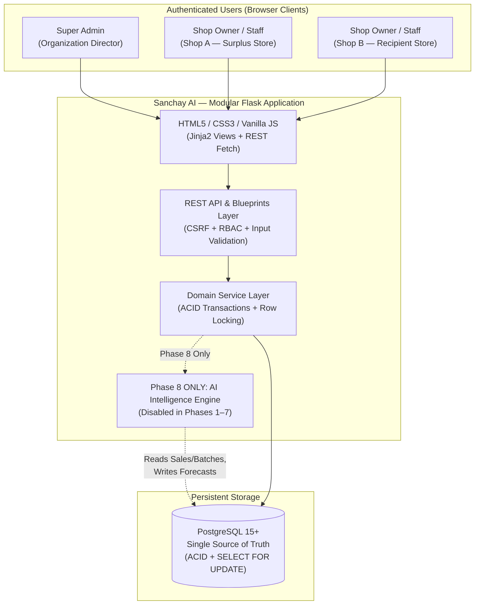
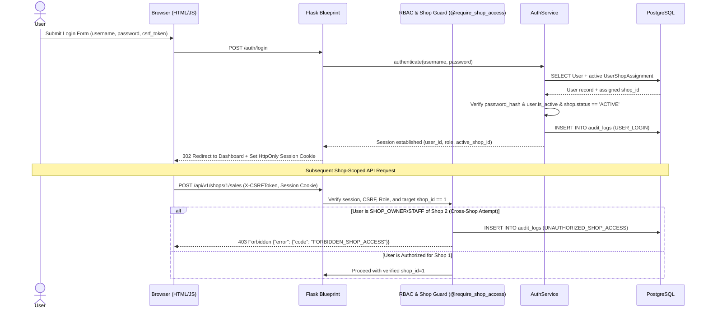
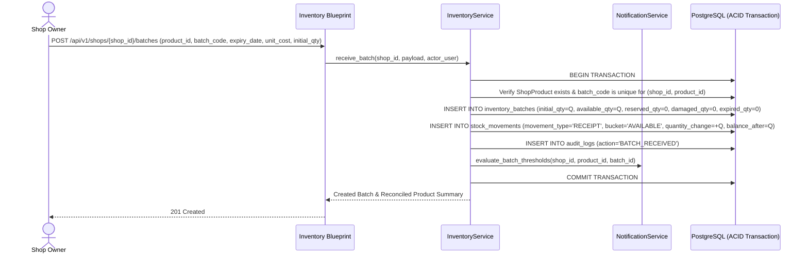
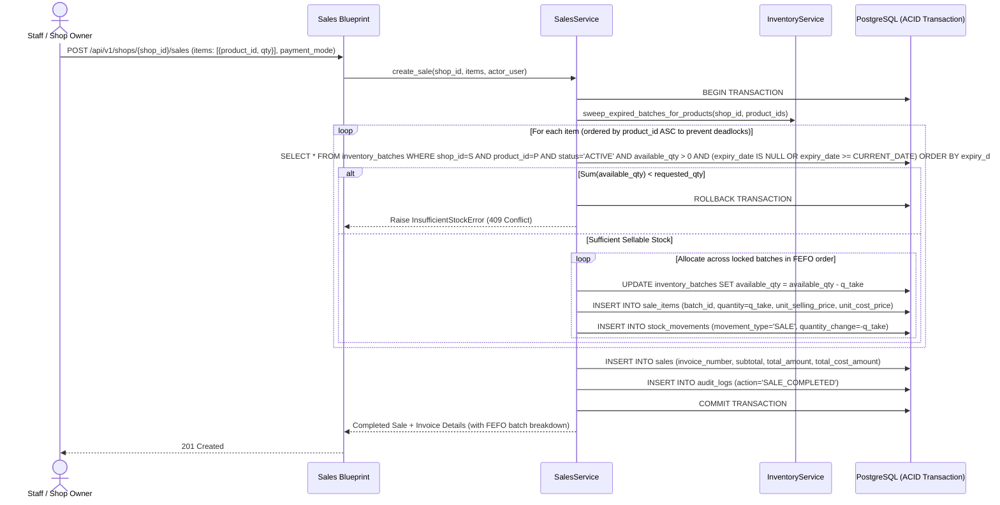
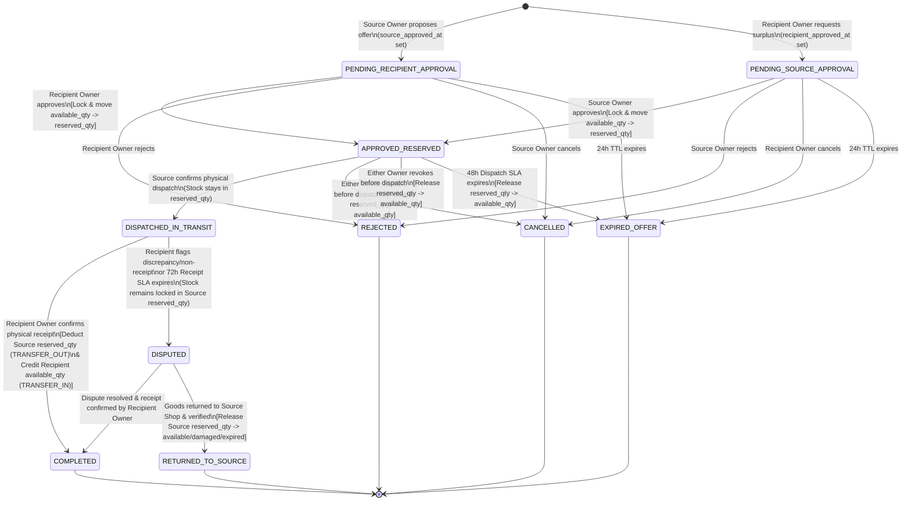

# Sanchay AI — System Architecture Document

**Document Status:** Phases 1–6 Implemented & Verified; Phases 7–8 Target Architecture  
**Related ADRs:** [`ADR-001`](file:///d:/Ashutosh_01/Sanchay%20AI/DECISIONS.md), [`ADR-002`](file:///d:/Ashutosh_01/Sanchay%20AI/DECISIONS.md), [`ADR-003`](file:///d:/Ashutosh_01/Sanchay%20AI/DECISIONS.md), [`ADR-007`](file:///d:/Ashutosh_01/Sanchay%20AI/DECISIONS.md), [`ADR-008`](file:///d:/Ashutosh_01/Sanchay%20AI/DECISIONS.md)

---

## 1. System Context Overview

**Sanchay AI** is designed as a **Modular Flask Monolith** backed by **PostgreSQL** as the single source of truth (`RULE-07`, `RULE-10`). It serves both server-rendered HTML5 views (Jinja2 + CSS3 + vanilla JavaScript) and RESTful JSON APIs (`/api/v1/*`) from a unified Flask application process.



---

## 2. Repository & Module Structure

Below is the repository structure showing implemented **Phase 1, Phase 2, Phase 3, Phase 4, Phase 5 & Phase 6** files alongside planned **Phases 7–8** modules:

```text
sanchay-ai/
├── app/
│   ├── __init__.py                 # [Phase 1-6 - Implemented] Flask Application Factory (create_app)
│   ├── config.py                   # [Phase 1-6 - Implemented] Development, Testing, Production & Analysis configs
│   ├── extensions.py               # [Phase 1 - Implemented] SQLAlchemy (db), Migrate, LoginManager, CSRFProtect
│   ├── cli.py                      # [Phase 1/2 - Implemented] Flask CLI commands (create-user with --org-code, db-check)
│   ├── models/                     # SQLAlchemy Declarative Models
│   │   ├── __init__.py             # [Phase 1-6 - Implemented]
│   │   ├── user.py                 # [Phase 1/2 - Implemented] User model (scrypt + session_token + organization_id)
│   │   ├── audit.py                # [Phase 1/2 - Implemented] AuditLog model (JSONB + organization_id + shop_id)
│   │   ├── organization.py         # [Phase 2 - Implemented] Organization, Shop, UserShopAssignment
│   │   ├── catalog.py              # [Phase 3 - Implemented] Product, ShopProduct
│   │   ├── inventory.py            # [Phase 3 - Implemented] InventoryBatch, StockMovement
│   │   ├── sales.py                # [Phase 4 - Implemented] Sale, SaleItem, SaleReturn
│   │   ├── transfer.py             # [Phase 6 - Implemented] TransferRequest, TransferStatusLog
│   │   ├── notification.py         # [Phase 7] Notification
│   │   └── ai_models.py            # [PHASE 8 ONLY] AIModelRun, AIForecast, AITransferRecommendation
│   ├── services/                   # Transactional Domain Logic Layer
│   │   ├── __init__.py
│   │   ├── auth_service.py         # [Phase 1/2 - Implemented] Authentication, password hashing, session validation
│   │   ├── org_service.py          # [Phase 2 - Implemented] OrganizationService, ShopService, MembershipService
│   │   ├── catalog_service.py      # [Phase 3 - Implemented] Product & ShopProduct CRUD
│   │   ├── inventory_service.py    # [Phase 3 - Implemented] Batch receipts, adjustments, expiry sweeps, reconciliation
│   │   ├── sales_service.py        # [Phase 4 - Implemented] POS billing, FEFO deduction, returns & cancellations
│   │   ├── surplus_service.py      # [Phase 5 - Implemented] Deterministic StockAnalysisService (SurplusService)
│   │   ├── transfer_service.py     # [Phase 6 - Implemented] Dual-approval state machine, reservation, dispatch, receipt
│   │   ├── notification_service.py # [Phase 7] In-app alert creation & deduplication
│   │   ├── report_service.py       # [Phase 7] Financial KPIs, wastage metrics, CSV/PDF generation
│   │   ├── audit_service.py        # [Phase 1/2 - Implemented] Immutable audit log recording
│   │   └── ai/                     # PHASE 8 ONLY: Forecasting & Expiry Risk Services
│   │       ├── __init__.py
│   │       ├── forecasting.py
│   │       ├── expiry_risk.py
│   │       ├── recommender.py
│   │       └── evaluation.py
│   ├── blueprints/                 # HTTP Route Controllers (UI + /api/v1/*)
│   │   ├── auth/                   # [Phase 1 - Implemented] Login, logout, password change
│   │   ├── admin/                  # [Phase 2 - Implemented] Org, Shop, and User/RBAC administration
│   │   ├── catalog/                # [Phase 3 - Implemented] Product catalog views & APIs
│   │   ├── inventory/              # [Phase 3 - Implemented] Batch management, adjustments, movement history
│   │   ├── sales/                  # [Phase 4 - Implemented] POS counter, invoices, receipts, returns & cancellations
│   │   ├── analysis/               # [Phase 5 - Implemented] Rule-based stock analysis, expiry risk, surplus & recommendations
│   │   ├── transfers/              # [Phase 6 - Implemented] Surplus discovery, transfer proposals, approvals, handover
│   │   ├── notifications/          # [Phase 7] Notification center & unread counts
│   │   ├── reports/                # [Phase 7] Dashboards, analytics, CSV/PDF exports
│   │   └── ai/                     # PHASE 8 ONLY: AI forecast & recommendation endpoints
│   ├── utils/
│   │   ├── decorators.py           # [Phase 2 - Implemented] @require_role, @require_organization_access, @require_shop_access
│   │   ├── errors.py               # [Phase 1-3 - Implemented] Domain exceptions & JSON error handlers
│   │   ├── validators.py           # [Phase 1-6 - Implemented] Input payload validation helpers
│   │   └── geo.py                  # [Phase 2 - Implemented] Haversine distance calculator
│   ├── templates/                  # Jinja2 HTML5 Templates (auth/, admin/, catalog/, inventory/, sales/, analysis/, transfers/, errors/)
│   └── static/                     # CSS3 stylesheets & modular vanilla JS (api.js, inventory.js, pos.js)
│       ├── css/
│       └── js/
├── migrations/                     # Alembic / Flask-Migrate schema versions
├── scripts/
│   └── seed_demo_data.py           # Explicit hackathon demo seed script (Phase 7)
├── tests/                          # pytest test suite (unit, integration, isolation, concurrency)
├── docs/                           # Extended project documentation
├── .env.example
├── .gitignore
├── requirements.txt                # Created in Phase 1
└── wsgi.py                         # WSGI entry point (Created in Phase 1)
```

---

## 3. Component Responsibilities & Boundaries

| Layer | Allowed Dependencies | Responsibilities | Strictly Forbidden |
| :--- | :--- | :--- | :--- |
| **Templates & Vanilla JS (`templates/`, `static/`)** | Calls `/api/v1/*` and renders server context | User interaction, form submission, CSRF header attachment, dynamic table rendering | Enforcing security rules, computing authoritative stock balances, hardcoding shop/product data |
| **Blueprints (`app/blueprints/`)** | `app/services/`, `app/utils/` | Parsing HTTP query/JSON inputs, invoking RBAC decorators, calling Service methods, formatting HTTP responses | Direct `db.session.add()` / `commit()` on domain models; mutating batch quantities directly |
| **Services (`app/services/`)** | `app/models/`, `db.session` | Enforcing `BR-001` to `BR-020`, managing ACID transactions, acquiring `SELECT ... FOR UPDATE` locks, writing `stock_movements` and `audit_logs` | Returning raw Flask `Response` objects or trusting unvalidated shop IDs |
| **Models (`app/models/`)** | `SQLAlchemy` (`db`) | Defining table schemas, column types, indexes, `FOREIGN KEY` and `CHECK` constraints | Executing cross-module workflows or HTTP request context lookups |
| **AI Engine (`app/services/ai/` — Phase 8 Only)** | Read-only on `sales`, `inventory_batches`; writes only to `ai_*` tables | Training statistical/ML demand models, scoring batch expiry risk, generating explainable recommendations | Directly modifying `inventory_batches` or auto-approving `transfer_requests` |

---

## 4. Core System Workflows & Sequence Diagrams

### 4.1 Authentication & RBAC / Shop Isolation Flow (`FR-006`, `FR-009`, `BR-013`, `BR-014`)



---

### 4.2 Inventory Receipt & Batch Reconciliation Flow (`FR-015` to `FR-019`, `BR-001` to `BR-003`)



---

### 4.3 Point-of-Sale (POS) Billing & FEFO Deduction Flow (`FR-028` to `FR-032`, `BR-004`, `BR-006`)



---

### 4.4 Inter-Store Stock Transfer State Machine & Workflow (`FR-038` to `FR-049`, `BR-008` to `BR-012`)

#### Transfer Lifecycle State Diagram



---

### 4.5 In-App Notifications & Event Alert Architecture (`Phase 7 Implemented`)

Phase 7 implements a lightweight, deterministic in-app notification system strictly scoped to authenticated users and their authorized shops without external queue or socket infrastructure.

#### Architectural Principles:
1. **Atomic In-Transaction Generation:** Notifications are created within the same database transaction as the underlying business action (e.g. transfer approval, batch receipt, dispatch). If a business transaction aborts or rolls back, no orphan notifications are committed.
2. **Shop Recipient Isolation:** Notifications are delivered only to active users assigned to the affected shop (`UserShopAssignment` with role `SHOP_OWNER` or `STAFF`). Cross-tenant or unassigned users never receive alerts.
3. **Database-Level Deduplication:** Every event notification supports an idempotent `dedup_key` (e.g., `NEAR_EXPIRY:{shop_id}:{batch_id}:{date}:user:{user_id}`). PostgreSQL enforces uniqueness via `uq_notifications_user_dedup(recipient_user_id, dedup_key)`.
4. **Lightweight Client Polling:** The frontend uses standard HTTP GET polling on `/api/v1/notifications/unread-count` (45-second interval) to update navbar bell counters and badges. No WebSockets, Redis, Celery, or background worker threads are utilized.
5. **No External Notification Gateways:** Strict conformance to Project Rules: no third-party SMS, WhatsApp, Email, or WebPush gateways are integrated.

---

### 4.6 Dashboards, Operational Analytics & Reporting Engine (`Phase 8 Implemented`)

Phase 8 implements multi-tier executive and store operational dashboards, trend analytics, categorical distribution breakdowns, tabular report generation, and streaming CSV export.

#### Architectural Principles:
1. **Multi-Role Dashboard Scoping:**
   - **Super Admin Executive Dashboard:** Displays network-wide KPIs (total/active shops, catalog products, aggregate stock units, total inventory valuation, gross sales revenue, COGS, gross margin, completed/pending transfers, near-expiry at-risk valuation, low stock and surplus counts) and a shop-by-shop operational performance breakdown.
   - **Shop Owner / Staff Operations Hub:** Dynamically scopes data to the active shop via `verify_shop_access`. Displays sellable vs. reserved vs. expired units, retail vs. cost valuation, store sales and gross profit margins, transfer pipeline, actionable replenishment and FEFO near-expiry alerts, and recent transaction feeds.
2. **Deterministic SQL Aggregation:** All dashboard and report queries compute real-time metrics directly from PostgreSQL transactional tables (`sales`, `sale_items`, `inventory_batches`, `shop_products`, `transfer_requests`, `stock_movements`). No mock data or unverified caches are used.
3. **Continuous Time-Series Interpolation:** Daily and monthly sales trends utilize zero-filled continuous date sequences between `start_date` and `end_date`, ensuring line charts and data series do not drop days with zero sales transactions.
4. **Streaming RFC 4180 CSV Export:** The `/api/v1/reports/export` endpoint streams CSV rows as a chunked HTTP generator via Python's standard `csv.writer`, avoiding excessive server memory overhead when exporting large transaction datasets.
5. **Zero-Dependency SVG Visualizations:** Visual charts (trend lines, horizontal bars, donut charts) are rendered via a lightweight custom client-side SVG engine (`SanchayCharts` in `app/static/js/charts.js`), eliminating external CDN dependencies, chart.js, or complex client frameworks.
6. **Strict Shop-Level Data Isolation:** API endpoints (`/api/v1/reports/shop/<id>/summary`, `/api/v1/reports/export`, etc.) enforce shop permission boundaries via `verify_shop_access`. Cross-store access by non-admin actors is rejected with `403 UNAUTHORIZED_SHOP_ACCESS`.

---

## 5. Future AI Integration Boundary (Phase 10 Isolation)

To enforce **Project Rules #3 and #4**, the AI subsystem in Phase 10 is architected behind a strict **Read-Compute-Recommend** boundary:

1. **Feature Extraction (Read-Only):** Phase 10 services read historical rows from `sales`, `sale_items`, `inventory_batches`, and `shops`.
2. **Isolated Persistence:** Phase 10 writes model metadata, demand forecasts, and transfer recommendations exclusively to dedicated tables (`ai_model_runs`, `ai_forecasts`, `ai_transfer_recommendations`).
3. **Human-in-the-Loop Action Boundary:** The AI module has **zero write access** to `inventory_batches`, `stock_movements`, or `transfer_requests`. When a Shop Owner clicks *"Propose Transfer"* on an AI recommendation, the frontend invokes the standard Phase 6 endpoint (`POST /api/v1/transfers`), which enforces the exact same dual-approval and physical handover state machine (`BR-008`, `BR-009`).
4. **Feature Flag & Fallback:** If `AI_ENABLED=false` (mandatory throughout Phases 1–8) or if a product has fewer than `AI_MIN_HISTORY_DAYS` of sales history, the application seamlessly uses Phase 5's deterministic `SurplusService`.
