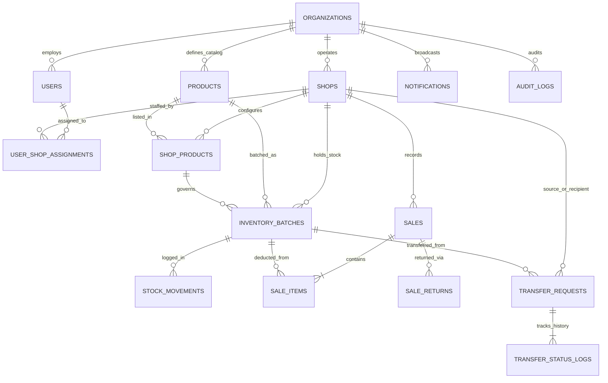

# Sanchay AI — PostgreSQL Database Schema Specification

**Database Engine:** PostgreSQL 15+  
**ORM & Migration Tooling:** SQLAlchemy 2.x (`Flask-SQLAlchemy`) + Alembic (`Flask-Migrate`)  
**Status:** Proposed Target Schema (Implemented progressively in Phases 1–6 and Phase 8)

---

## 1. Entity-Relationship Diagram (ERD)

---

## 2. Table Definitions, Constraints & Indexes

### 2.1 `organizations` (Implemented in Phase 2 — Migration `0002_phase2_org_shops`)
Stores the top-level retail organization connecting all shops.

| Column | Type | Constraints / Defaults | Description |
| :--- | :--- | :--- | :--- |
| `id` | `BIGSERIAL` / `BIGINT` | `PRIMARY KEY` | Surrogate primary key |
| `name` | `VARCHAR(150)` | `NOT NULL` | Legal/display name of the organization |
| `code` | `VARCHAR(32)` | `NOT NULL UNIQUE` | Unique short code (e.g., `SANCHAY_A`) |
| `contact_email` | `VARCHAR(150)` | `NULL` | Organization contact email |
| `contact_phone` | `VARCHAR(20)` | `NULL` | Organization contact phone |
| `address` | `TEXT` | `NULL` | Headquarters street address |
| `low_stock_default_threshold` | `INTEGER` | `NOT NULL DEFAULT 10 CHECK (low_stock_default_threshold >= 0)` | Organization-wide default low-stock threshold |
| `near_expiry_days_threshold` | `INTEGER` | `NOT NULL DEFAULT 15 CHECK (near_expiry_days_threshold >= 1)` | Organization-wide default near-expiry window (days) |
| `status` | `VARCHAR(20)` | `NOT NULL DEFAULT 'ACTIVE' CHECK (status IN ('ACTIVE', 'INACTIVE'))` | Operational status |
| `created_at` | `TIMESTAMPTZ` | `NOT NULL DEFAULT NOW()` | Creation timestamp (UTC) |
| `updated_at` | `TIMESTAMPTZ` | `NOT NULL DEFAULT NOW()` | Last update timestamp (UTC) |

- **Indexes:** `idx_organizations_status ON organizations(status)`

---

### 2.2 `shops` (Implemented in Phase 2 — Migration `0002_phase2_org_shops`)
Represents individual retail stores belonging to an organization.

| Column | Type | Constraints / Defaults | Description |
| :--- | :--- | :--- | :--- |
| `id` | `BIGSERIAL` / `BIGINT` | `PRIMARY KEY` | Surrogate primary key |
| `organization_id` | `BIGINT` | `NOT NULL REFERENCES organizations(id) ON DELETE RESTRICT` | Owning organization |
| `name` | `VARCHAR(150)` | `NOT NULL` | Store display name |
| `code` | `VARCHAR(32)` | `NOT NULL` | Store code unique per organization (e.g., `SHP-BLR-01`) |
| `address` | `TEXT` | `NOT NULL` | Street address |
| `city` | `VARCHAR(80)` | `NOT NULL` | City name |
| `pincode` | `VARCHAR(12)` | `NOT NULL` | Postal code |
| `latitude` | `NUMERIC(9,6)` | `NULL CHECK (latitude BETWEEN -90 AND 90)` | Latitude for distance calculation |
| `longitude` | `NUMERIC(9,6)` | `NULL CHECK (longitude BETWEEN -180 AND 180)` | Longitude for distance calculation |
| `contact_phone` | `VARCHAR(20)` | `NOT NULL` | Shop contact number |
| `contact_email` | `VARCHAR(150)` | `NULL` | Shop contact email |
| `low_stock_default_threshold` | `INTEGER` | `NOT NULL DEFAULT 10 CHECK (low_stock_default_threshold >= 0)` | Default low-stock alert threshold |
| `near_expiry_days_threshold` | `INTEGER` | `NOT NULL DEFAULT 15 CHECK (near_expiry_days_threshold >= 1)` | Default days before expiry to trigger alert |
| `status` | `VARCHAR(20)` | `NOT NULL DEFAULT 'ACTIVE' CHECK (status IN ('ACTIVE', 'INACTIVE', 'SUSPENDED'))` | Shop operational status |
| `created_at` | `TIMESTAMPTZ` | `NOT NULL DEFAULT NOW()` | Creation timestamp |
| `updated_at` | `TIMESTAMPTZ` | `NOT NULL DEFAULT NOW()` | Update timestamp |

- **Unique Constraints:** `uq_shops_org_code UNIQUE (organization_id, code)`
- **Indexes:** `idx_shops_org_status ON shops(organization_id, status)`

---

### 2.3 `users` (Implemented in Phase 1 & Extended in Phase 2 — Migrations `0001`, `0002`)
Stores all user accounts (`SUPER_ADMIN`, `SHOP_OWNER`, `STAFF`). `organization_id` foreign key added in Phase 2.

| Column | Type | Constraints / Defaults | Description |
| :--- | :--- | :--- | :--- |
| `id` | `BIGSERIAL` / `BIGINT` | `PRIMARY KEY` | Surrogate primary key |
| `organization_id` | `BIGINT` | `NULL REFERENCES organizations(id) ON DELETE RESTRICT` | Tenant organization membership (Added in Phase 2) |
| `username` | `VARCHAR(64)` | `NOT NULL UNIQUE` | Login username (lowercase normalized) |
| `email` | `VARCHAR(150)` | `NOT NULL UNIQUE` | Login email address (lowercase normalized) |
| `password_hash` | `VARCHAR(256)` | `NOT NULL` | Hashed password (`scrypt`) |
| `full_name` | `VARCHAR(120)` | `NOT NULL` | Full display name |
| `phone` | `VARCHAR(20)` | `NULL` | Contact number |
| `role` | `VARCHAR(20)` | `NOT NULL DEFAULT 'STAFF' CHECK (role IN ('SUPER_ADMIN', 'SHOP_OWNER', 'STAFF'))` | System role |
| `is_active` | `BOOLEAN` | `NOT NULL DEFAULT TRUE` | Account active flag |
| `session_token` | `VARCHAR(64)` | `NOT NULL` | Server-side session token rotated on login, logout, password change, and role/status change |
| `last_login_at` | `TIMESTAMPTZ` | `NULL` | Most recent login timestamp |
| `created_at` | `TIMESTAMPTZ` | `NOT NULL DEFAULT NOW()` | Creation timestamp |
| `updated_at` | `TIMESTAMPTZ` | `NOT NULL DEFAULT NOW()` | Update timestamp |

- **Indexes:** `idx_users_role_active ON users(role, is_active)`, `idx_users_org_role ON users(organization_id, role)`

---

### 2.4 `user_shop_assignments` (Implemented in Phase 2 — Migration `0002_phase2_org_shops`)
Binds `SHOP_OWNER` and `STAFF` users to specific shops (`OD-001`).

| Column | Type | Constraints / Defaults | Description |
| :--- | :--- | :--- | :--- |
| `id` | `BIGSERIAL` / `BIGINT` | `PRIMARY KEY` | Surrogate primary key |
| `user_id` | `BIGINT` | `NOT NULL REFERENCES users(id) ON DELETE RESTRICT` | Assigned user |
| `shop_id` | `BIGINT` | `NOT NULL REFERENCES shops(id) ON DELETE RESTRICT` | Assigned shop |
| `assignment_role` | `VARCHAR(20)` | `NOT NULL CHECK (assignment_role IN ('SHOP_OWNER', 'STAFF'))` | Role within the shop |
| `is_primary` | `BOOLEAN` | `NOT NULL DEFAULT TRUE` | Primary shop context for the user |
| `is_active` | `BOOLEAN` | `NOT NULL DEFAULT TRUE` | Whether assignment is currently active |
| `assigned_by_user_id` | `BIGINT` | `NULL REFERENCES users(id) ON DELETE RESTRICT` | Admin/Owner who created assignment |
| `assigned_at` | `TIMESTAMPTZ` | `NOT NULL DEFAULT NOW()` | Assignment timestamp |
| `updated_at` | `TIMESTAMPTZ` | `NOT NULL DEFAULT NOW()` | Last update timestamp |

- **Unique Constraints & Indexes:**
  - `uq_user_shop UNIQUE (user_id, shop_id)`
  - `idx_usa_shop_role_active ON user_shop_assignments(shop_id, assignment_role, is_active)`
  - Partial unique index enforcing 1 primary active shop per user (`OD-001`): `CREATE UNIQUE INDEX uq_user_active_primary_shop ON user_shop_assignments(user_id) WHERE is_active = TRUE AND is_primary = TRUE;`

---

### 2.5 `products` (Created in Phase 3)
Canonical product identity within the organization (`ADR-006`) so cross-shop transfers match identical SKUs deterministically.

| Column | Type | Constraints / Defaults | Description |
| :--- | :--- | :--- | :--- |
| `id` | `BIGINT` | `PRIMARY KEY GENERATED ALWAYS AS IDENTITY` | Surrogate primary key |
| `organization_id` | `BIGINT` | `NOT NULL REFERENCES organizations(id) ON DELETE RESTRICT` | Owning organization |
| `sku` | `VARCHAR(64)` | `NOT NULL` | Canonical SKU / product code (e.g., `SKU-DAIRY-PANEER-200G`) |
| `name` | `VARCHAR(150)` | `NOT NULL` | Product display name |
| `category` | `VARCHAR(80)` | `NOT NULL` | Category (e.g., `Dairy`, `Bakery`, `Beverages`, `Staples`, `Snacks`) |
| `unit` | `VARCHAR(20)` | `NOT NULL CHECK (unit IN ('pcs', 'pack', 'kg', 'g', 'litre', 'ml', 'box'))` | Unit of measure |
| `description` | `TEXT` | `NULL` | Optional product notes |
| `is_perishable` | `BOOLEAN` | `NOT NULL DEFAULT TRUE` | If `TRUE`, batches require `expiry_date` |
| `default_purchase_price` | `NUMERIC(12,2)` | `NOT NULL CHECK (default_purchase_price >= 0)` | Reference purchase cost |
| `default_selling_price` | `NUMERIC(12,2)` | `NOT NULL CHECK (default_selling_price >= 0)` | Reference retail selling price |
| `is_active` | `BOOLEAN` | `NOT NULL DEFAULT TRUE` | Master active flag |
| `created_by_user_id` | `BIGINT` | `NOT NULL REFERENCES users(id) ON DELETE RESTRICT` | Creator user |
| `created_at` | `TIMESTAMPTZ` | `NOT NULL DEFAULT NOW()` | Creation timestamp |
| `updated_at` | `TIMESTAMPTZ` | `NOT NULL DEFAULT NOW()` | Update timestamp |

- **Unique Constraints:** `uq_products_org_sku UNIQUE (organization_id, sku)`
- **Indexes:** `idx_products_org_category ON products(organization_id, category)`

---

### 2.6 `shop_products` (Created in Phase 3)
Shop-specific catalog configuration, local pricing, and alert thresholds (`FR-014`).

| Column | Type | Constraints / Defaults | Description |
| :--- | :--- | :--- | :--- |
| `id` | `BIGINT` | `PRIMARY KEY GENERATED ALWAYS AS IDENTITY` | Surrogate primary key |
| `shop_id` | `BIGINT` | `NOT NULL REFERENCES shops(id) ON DELETE RESTRICT` | Owning shop |
| `product_id` | `BIGINT` | `NOT NULL REFERENCES products(id) ON DELETE RESTRICT` | Linked canonical product |
| `purchase_price` | `NUMERIC(12,2)` | `NOT NULL CHECK (purchase_price >= 0)` | Shop's default purchase price |
| `selling_price` | `NUMERIC(12,2)` | `NOT NULL CHECK (selling_price >= 0)` | Shop's POS selling price |
| `low_stock_threshold` | `INTEGER` | `NOT NULL DEFAULT 10 CHECK (low_stock_threshold >= 0)` | Low-stock alert trigger level |
| `near_expiry_days` | `INTEGER` | `NOT NULL DEFAULT 15 CHECK (near_expiry_days >= 1)` | Days before expiry to flag near-expiry |
| `surplus_threshold` | `INTEGER` | `NOT NULL DEFAULT 40 CHECK (surplus_threshold >= 1)` | Quantity above which overstock rule triggers |
| `is_active` | `BOOLEAN` | `NOT NULL DEFAULT TRUE` | Whether carried actively by this shop |
| `created_at` | `TIMESTAMPTZ` | `NOT NULL DEFAULT NOW()` | Creation timestamp |
| `updated_at` | `TIMESTAMPTZ` | `NOT NULL DEFAULT NOW()` | Update timestamp |

- **Unique Constraints:** `uq_shop_products_shop_product UNIQUE (shop_id, product_id)`
- **Indexes:** `idx_shop_products_shop_active ON shop_products(shop_id, is_active)`

---

### 2.7 `inventory_batches` (Created in Phase 3)
Canonical batch-level physical inventory (`ADR-004`, `BR-001`, `BR-002`, `BR-003`).

| Column | Type | Constraints / Defaults | Description |
| :--- | :--- | :--- | :--- |
| `id` | `BIGINT` | `PRIMARY KEY GENERATED ALWAYS AS IDENTITY` | Surrogate primary key |
| `shop_id` | `BIGINT` | `NOT NULL REFERENCES shops(id) ON DELETE RESTRICT` | Owning shop |
| `product_id` | `BIGINT` | `NOT NULL REFERENCES products(id) ON DELETE RESTRICT` | Product reference |
| `shop_product_id` | `BIGINT` | `NOT NULL REFERENCES shop_products(id) ON DELETE RESTRICT` | Shop product reference |
| `batch_code` | `VARCHAR(64)` | `NOT NULL` | Batch identifier (e.g., `BATCH-202610-A1`) |
| `manufactured_date` | `DATE` | `NULL` | Date of manufacture |
| `expiry_date` | `DATE` | `NULL` | Expiry date (mandatory if perishable) |
| `unit_cost` | `NUMERIC(12,2)` | `NOT NULL CHECK (unit_cost >= 0)` | Purchase/transfer unit cost for this batch |
| `initial_qty` | `INTEGER` | `NOT NULL CHECK (initial_qty > 0)` | Initial quantity received into this batch |
| `available_qty` | `INTEGER` | `NOT NULL CHECK (available_qty >= 0)` | Unreserved, sellable quantity |
| `reserved_qty` | `INTEGER` | `NOT NULL DEFAULT 0 CHECK (reserved_qty >= 0)` | Quantity reserved for approved outgoing transfers |
| `damaged_qty` | `INTEGER` | `NOT NULL DEFAULT 0 CHECK (damaged_qty >= 0)` | Unsellable damaged units |
| `expired_qty` | `INTEGER` | `NOT NULL DEFAULT 0 CHECK (expired_qty >= 0)` | Unsellable expired units |
| `source_transfer_id` | `BIGINT` | `NULL` | If created via inter-store transfer, links to `transfer_requests.id` |
| `status` | `VARCHAR(20)` | `NOT NULL DEFAULT 'ACTIVE' CHECK (status IN ('ACTIVE', 'DEPLETED', 'EXPIRED', 'ARCHIVED'))` | Batch lifecycle status |
| `received_at` | `TIMESTAMPTZ` | `NOT NULL DEFAULT NOW()` | Receipt timestamp |
| `created_at` | `TIMESTAMPTZ` | `NOT NULL DEFAULT NOW()` | Creation timestamp |
| `updated_at` | `TIMESTAMPTZ` | `NOT NULL DEFAULT NOW()` | Update timestamp |

- **Unique Constraints:** `uq_batches_shop_product_code UNIQUE (shop_id, product_id, batch_code)`
- **Check Constraints:**
  - `chk_batch_dates CHECK (manufactured_date IS NULL OR expiry_date IS NULL OR expiry_date >= manufactured_date)`
- **Indexes:**
  - `idx_batches_fefo ON inventory_batches(shop_id, product_id, status, expiry_date ASC NULLS LAST, received_at ASC)`
  - `idx_batches_expiry ON inventory_batches(shop_id, expiry_date) WHERE status = 'ACTIVE'`

---

### 2.8 `stock_movements` (Created in Phase 3)
Immutable ledger recording every single change to any batch bucket (`BR-002`, `BR-007`).

| Column | Type | Constraints / Defaults | Description |
| :--- | :--- | :--- | :--- |
| `id` | `BIGINT` | `PRIMARY KEY GENERATED ALWAYS AS IDENTITY` | Surrogate primary key |
| `shop_id` | `BIGINT` | `NOT NULL REFERENCES shops(id) ON DELETE RESTRICT` | Shop where movement occurred |
| `product_id` | `BIGINT` | `NOT NULL REFERENCES products(id) ON DELETE RESTRICT` | Product reference |
| `batch_id` | `BIGINT` | `NOT NULL REFERENCES inventory_batches(id) ON DELETE RESTRICT` | Affected batch |
| `movement_type` | `VARCHAR(32)` | `NOT NULL CHECK (movement_type IN ('RECEIPT', 'SALE', 'SALE_RETURN', 'SALE_CANCELLATION', 'ADJUSTMENT_ADD', 'ADJUSTMENT_SUBTRACT', 'MARK_DAMAGED', 'MARK_EXPIRED', 'TRANSFER_RESERVE', 'TRANSFER_RELEASE', 'TRANSFER_OUT', 'TRANSFER_IN'))` | Type of stock mutation |
| `bucket_affected` | `VARCHAR(20)` | `NOT NULL CHECK (bucket_affected IN ('AVAILABLE', 'RESERVED', 'DAMAGED', 'EXPIRED'))` | Which batch bucket changed |
| `quantity_change` | `INTEGER` | `NOT NULL CHECK (quantity_change != 0)` | Signed quantity delta (`+` or `-`) |
| `balance_after` | `INTEGER` | `NOT NULL CHECK (balance_after >= 0)` | Bucket balance immediately after mutation |
| `unit_cost_snapshot` | `NUMERIC(12,2)` | `NOT NULL CHECK (unit_cost_snapshot >= 0)` | Batch unit cost at time of movement |
| `reference_type` | `VARCHAR(32)` | `NOT NULL CHECK (reference_type IN ('INITIAL_RECEIPT', 'SALE', 'SALE_RETURN', 'TRANSFER', 'MANUAL_ADJUSTMENT', 'EXPIRY_SWEEP'))` | Source workflow |
| `reference_id` | `BIGINT` | `NULL` | ID of `sales.id`, `transfer_requests.id`, etc. |
| `reason` | `TEXT` | `NULL` | Mandatory notes for manual adjustments |
| `performed_by_user_id` | `BIGINT` | `NULL REFERENCES users(id) ON DELETE RESTRICT` | User who triggered movement (`NULL` if system sweep) |
| `created_at` | `TIMESTAMPTZ` | `NOT NULL DEFAULT NOW()` | Movement timestamp |

- **Indexes:**
  - `idx_movements_shop_created ON stock_movements(shop_id, created_at DESC)`
  - `idx_movements_batch ON stock_movements(batch_id, created_at ASC)`

---

### 2.9 `sales`, `sale_items`, and `sale_returns` (Created & Verified in Phase 4 — `0004_phase4_sales_billing`)

#### Table: `sales`
| Column | Type | Constraints / Defaults | Description |
| :--- | :--- | :--- | :--- |
| `id` | `BIGINT` | `PRIMARY KEY GENERATED ALWAYS AS IDENTITY` | Surrogate primary key |
| `organization_id` | `BIGINT` | `NOT NULL REFERENCES organizations(id) ON DELETE RESTRICT` | Owning organization |
| `shop_id` | `BIGINT` | `NOT NULL REFERENCES shops(id) ON DELETE RESTRICT` | Selling shop |
| `invoice_number` | `VARCHAR(48)` | `NOT NULL` | Sequential invoice number per shop (`INV-SHP1-20261012-0001`) |
| `idempotency_key` | `VARCHAR(80)` | `NULL` | Optional client/header idempotency key preventing duplicate checkout submission |
| `customer_name` | `VARCHAR(120)` | `NULL` | Optional walk-in customer name |
| `customer_phone` | `VARCHAR(20)` | `NULL` | Optional customer phone |
| `status` | `VARCHAR(24)` | `NOT NULL DEFAULT 'COMPLETED' CHECK (status IN ('COMPLETED', 'PARTIALLY_RETURNED', 'RETURNED', 'CANCELLED'))` | Sale status |
| `subtotal_amount` | `NUMERIC(12,2)` | `NOT NULL CHECK (subtotal_amount >= 0)` | Gross sum before discount |
| `discount_amount` | `NUMERIC(12,2)` | `NOT NULL DEFAULT 0.00 CHECK (discount_amount >= 0)` | Total discount applied |
| `total_amount` | `NUMERIC(12,2)` | `NOT NULL CHECK (total_amount >= 0)` | Final billed amount (`subtotal - discount`) |
| `total_cost_amount` | `NUMERIC(12,2)` | `NOT NULL CHECK (total_cost_amount >= 0)` | Sum of `quantity * unit_cost_price` (COGS) |
| `returned_amount` | `NUMERIC(12,2)` | `NOT NULL DEFAULT 0.00 CHECK (returned_amount >= 0)` | Cumulative amount refunded via returns |
| `payment_mode` | `VARCHAR(20)` | `NOT NULL DEFAULT 'CASH' CHECK (payment_mode IN ('CASH', 'UPI_MANUAL', 'CARD_MANUAL', 'OTHER'))` | Bookkeeping payment method |
| `notes` | `TEXT` | `NULL` | Optional bill remarks |
| `sold_by_user_id` | `BIGINT` | `NOT NULL REFERENCES users(id) ON DELETE RESTRICT` | Cashier/Owner who created sale |
| `cancelled_by_user_id` | `BIGINT` | `NULL REFERENCES users(id) ON DELETE RESTRICT` | User who cancelled sale |
| `cancelled_at` | `TIMESTAMPTZ` | `NULL` | Cancellation timestamp |
| `cancellation_reason` | `TEXT` | `NULL` | Mandatory reason if cancelled |
| `created_at` | `TIMESTAMPTZ` | `NOT NULL DEFAULT NOW()` | Sale timestamp |
| `updated_at` | `TIMESTAMPTZ` | `NOT NULL DEFAULT NOW()` | Last update timestamp |

- **Unique Constraints:** `uq_sales_shop_invoice UNIQUE (shop_id, invoice_number)`, `uq_sales_shop_idempotency UNIQUE (shop_id, idempotency_key)`
- **Check Constraints:** `ck_sales_status_valid`, `ck_sales_payment_mode_valid`, `ck_sales_amounts_nonnegative`, `ck_sales_discount_bounds` (`discount_amount <= subtotal_amount AND total_amount = subtotal_amount - discount_amount`), `ck_sales_returned_bounds` (`returned_amount <= total_amount`)
- **Indexes:** `idx_sales_shop_created ON sales(shop_id, created_at)`, `idx_sales_shop_status ON sales(shop_id, status)`

#### Table: `sale_items`
| Column | Type | Constraints / Defaults | Description |
| :--- | :--- | :--- | :--- |
| `id` | `BIGINT` | `PRIMARY KEY GENERATED ALWAYS AS IDENTITY` | Surrogate primary key |
| `sale_id` | `BIGINT` | `NOT NULL REFERENCES sales(id) ON DELETE RESTRICT` | Parent sale |
| `shop_id` | `BIGINT` | `NOT NULL REFERENCES shops(id) ON DELETE RESTRICT` | Selling shop |
| `product_id` | `BIGINT` | `NOT NULL REFERENCES products(id) ON DELETE RESTRICT` | Sold product |
| `shop_product_id` | `BIGINT` | `NOT NULL REFERENCES shop_products(id) ON DELETE RESTRICT` | Shop product configuration at sale time |
| `batch_id` | `BIGINT` | `NOT NULL REFERENCES inventory_batches(id) ON DELETE RESTRICT` | Specific batch deducted via FEFO |
| `quantity` | `INTEGER` | `NOT NULL CHECK (quantity > 0)` | Units deducted from this batch |
| `returned_quantity` | `INTEGER` | `NOT NULL DEFAULT 0 CHECK (returned_quantity >= 0 AND returned_quantity <= quantity)` | Units subsequently returned |
| `unit_selling_price` | `NUMERIC(12,2)` | `NOT NULL CHECK (unit_selling_price >= 0)` | Unit retail price snapshot at time of sale |
| `unit_cost_price` | `NUMERIC(12,2)` | `NOT NULL CHECK (unit_cost_price >= 0)` | Snapshot of `batch.unit_cost` at time of sale |
| `line_discount` | `NUMERIC(12,2)` | `NOT NULL DEFAULT 0.00 CHECK (line_discount >= 0)` | Discount allocated to this batch split |
| `line_total` | `NUMERIC(12,2)` | `NOT NULL CHECK (line_total >= 0)` | `(quantity * unit_selling_price) - line_discount` |
| `created_at` | `TIMESTAMPTZ` | `NOT NULL DEFAULT NOW()` | Line allocation timestamp |

- **Check Constraints:** `ck_sale_items_qty_positive`, `ck_sale_items_returned_qty_bounds`, `ck_sale_items_prices_nonnegative`, `ck_sale_items_line_total_math`
- **Indexes:** `idx_sale_items_sale ON sale_items(sale_id)`, `idx_sale_items_shop_product ON sale_items(shop_id, product_id)`, `idx_sale_items_batch ON sale_items(batch_id)`

#### Table: `sale_returns`
| Column | Type | Constraints / Defaults | Description |
| :--- | :--- | :--- | :--- |
| `id` | `BIGINT` | `PRIMARY KEY GENERATED ALWAYS AS IDENTITY` | Surrogate primary key |
| `sale_id` | `BIGINT` | `NOT NULL REFERENCES sales(id) ON DELETE RESTRICT` | Original sale |
| `sale_item_id` | `BIGINT` | `NOT NULL REFERENCES sale_items(id) ON DELETE RESTRICT` | Original sale line item |
| `shop_id` | `BIGINT` | `NOT NULL REFERENCES shops(id) ON DELETE RESTRICT` | Shop processing return |
| `product_id` | `BIGINT` | `NOT NULL REFERENCES products(id) ON DELETE RESTRICT` | Returned product |
| `batch_id` | `BIGINT` | `NOT NULL REFERENCES inventory_batches(id) ON DELETE RESTRICT` | Target batch |
| `quantity_returned` | `INTEGER` | `NOT NULL CHECK (quantity_returned > 0)` | Returned quantity |
| `return_condition` | `VARCHAR(20)` | `NOT NULL CHECK (return_condition IN ('RESELLABLE', 'DAMAGED', 'EXPIRED'))` | Customer return inspection condition |
| `stock_bucket_restored` | `VARCHAR(20)` | `NOT NULL CHECK (stock_bucket_restored IN ('AVAILABLE', 'DAMAGED', 'EXPIRED'))` | Actual batch bucket incremented (auto-routes `RESELLABLE` to `EXPIRED` if batch expired since sale) |
| `refund_amount` | `NUMERIC(12,2)` | `NOT NULL CHECK (refund_amount >= 0)` | Pro-rata amount refunded |
| `reason` | `TEXT` | `NOT NULL` | Reason for return |
| `idempotency_key` | `VARCHAR(80)` | `NULL` | Optional idempotency key preventing duplicate return submission |
| `processed_by_user_id` | `BIGINT` | `NOT NULL REFERENCES users(id) ON DELETE RESTRICT` | Staff/Owner who processed return |
| `created_at` | `TIMESTAMPTZ` | `NOT NULL DEFAULT NOW()` | Return timestamp |

- **Unique Constraints:** `uq_sale_returns_shop_idempotency UNIQUE (shop_id, idempotency_key)`
- **Indexes:** `idx_sale_returns_sale ON sale_returns(sale_id)`, `idx_sale_returns_shop_created ON sale_returns(shop_id, created_at)`

---

### 2.10 `transfer_requests` and `transfer_status_logs` (Created in Phase 6)

#### Table: `transfer_requests`
| Column | Type | Constraints / Defaults | Description |
| :--- | :--- | :--- | :--- |
| `id` | `BIGINT` | `PRIMARY KEY GENERATED ALWAYS AS IDENTITY` | Surrogate primary key |
| `transfer_code` | `VARCHAR(48)` | `NOT NULL UNIQUE` | Human-readable code (`TRF-20261012-0001`) |
| `organization_id` | `BIGINT` | `NOT NULL REFERENCES organizations(id) ON DELETE RESTRICT` | Owning organization |
| `source_shop_id` | `BIGINT` | `NOT NULL REFERENCES shops(id) ON DELETE RESTRICT` | Shop supplying surplus stock |
| `recipient_shop_id` | `BIGINT` | `NOT NULL REFERENCES shops(id) ON DELETE RESTRICT` | Shop receiving stock |
| `product_id` | `BIGINT` | `NOT NULL REFERENCES products(id) ON DELETE RESTRICT` | Product being transferred |
| `source_batch_id` | `BIGINT` | `NOT NULL REFERENCES inventory_batches(id) ON DELETE RESTRICT` | Source batch in `source_shop` |
| `recipient_batch_id` | `BIGINT` | `NULL REFERENCES inventory_batches(id) ON DELETE RESTRICT` | Created/updated batch in `recipient_shop` upon `COMPLETED` |
| `quantity` | `INTEGER` | `NOT NULL CHECK (quantity > 0)` | Number of units proposed/reserved |
| `received_good_qty` | `INTEGER` | `NULL CHECK (received_good_qty >= 0)` | Good units confirmed received by recipient |
| `transit_damaged_qty` | `INTEGER` | ` NOT NULL DEFAULT 0 CHECK (transit_damaged_qty >= 0)` | Units damaged in transit (if any) |
| `unit_transfer_price` | `NUMERIC(12,2)` | `NOT NULL CHECK (unit_transfer_price >= 0)` | Agreed internal transfer unit price |
| `estimated_distance_km` | `NUMERIC(8,2)` | `NULL CHECK (estimated_distance_km >= 0)` | Distance between shops |
| `transfer_logistics_cost` | `NUMERIC(12,2)` | `NOT NULL DEFAULT 0.00 CHECK (transfer_logistics_cost >= 0)` | Estimated transport cost |
| `batch_expiry_date_snapshot` | `DATE` | `NULL` | Snapshot of `source_batch.expiry_date` at creation |
| `status` | `VARCHAR(32)` | `NOT NULL CHECK (status IN ('PENDING_SOURCE_APPROVAL', 'PENDING_RECIPIENT_APPROVAL', 'APPROVED_RESERVED', 'DISPATCHED_IN_TRANSIT', 'COMPLETED', 'REJECTED', 'CANCELLED', 'EXPIRED_OFFER', 'DISPUTED', 'RETURNED_TO_SOURCE'))` | Current state machine status |
| `initiated_by_shop_id` | `BIGINT` | `NOT NULL REFERENCES shops(id) ON DELETE RESTRICT` | Which shop initiated the offer/request |
| `initiated_by_user_id` | `BIGINT` | `NOT NULL REFERENCES users(id) ON DELETE RESTRICT` | User who created proposal |
| `source_approved_by_user_id` | `BIGINT` | `NULL REFERENCES users(id) ON DELETE RESTRICT` | Source Shop Owner who approved |
| `source_approved_at` | `TIMESTAMPTZ` | `NULL` | Timestamp of Source Shop Owner approval |
| `recipient_approved_by_user_id` | `BIGINT` | `NULL REFERENCES users(id) ON DELETE RESTRICT` | Recipient Shop Owner who approved |
| `recipient_approved_at` | `TIMESTAMPTZ` | `NULL` | Timestamp of Recipient Shop Owner approval |
| `reserved_at` | `TIMESTAMPTZ` | `NULL` | Timestamp when stock entered `reserved_qty` |
| `offer_expires_at` | `TIMESTAMPTZ` | `NOT NULL` | Expiration deadline for pending offer |
| `dispatched_by_user_id` | `BIGINT` | `NULL REFERENCES users(id) ON DELETE RESTRICT` | Source user who confirmed physical dispatch |
| `dispatched_at` | `TIMESTAMPTZ` | `NULL` | Dispatch timestamp |
| `dispatch_notes` | `TEXT` | `NULL` | Handover / courier / vehicle notes |
| `received_by_user_id` | `BIGINT` | `NULL REFERENCES users(id) ON DELETE RESTRICT` | Recipient Shop Owner who confirmed physical receipt |
| `received_at` | `TIMESTAMPTZ` | `NULL` | Receipt confirmation timestamp |
| `receipt_notes` | `TEXT` | `NULL` | Receipt / inspection remarks |
| `rejection_or_cancel_reason` | `TEXT` | `NULL` | Reason if `REJECTED`, `CANCELLED`, or `DISPUTED` |
| `created_at` | `TIMESTAMPTZ` | `NOT NULL DEFAULT NOW()` | Proposal creation timestamp |
| `updated_at` | `TIMESTAMPTZ` | `NOT NULL DEFAULT NOW()` | Last update timestamp |

- **Check Constraints:**
  - `chk_transfer_distinct_shops CHECK (source_shop_id != recipient_shop_id)`
  - `chk_transfer_completed_requires_approvals CHECK (status != 'COMPLETED' OR (source_approved_at IS NOT NULL AND recipient_approved_at IS NOT NULL AND dispatched_at IS NOT NULL AND received_at IS NOT NULL))`
  - `chk_transfer_reserved_requires_dual_approval CHECK (status NOT IN ('APPROVED_RESERVED', 'DISPATCHED_IN_TRANSIT') OR (source_approved_at IS NOT NULL AND recipient_approved_at IS NOT NULL))`
- **Indexes:**
  - `idx_transfers_source_status ON transfer_requests(source_shop_id, status)`
  - `idx_transfers_recipient_status ON transfer_requests(recipient_shop_id, status)`
  - `idx_transfers_source_batch_active ON transfer_requests(source_batch_id, status)`

#### Table: `transfer_status_logs`
| Column | Type | Constraints / Defaults | Description |
| :--- | :--- | :--- | :--- |
| `id` | `BIGINT` | `PRIMARY KEY GENERATED ALWAYS AS IDENTITY` | Surrogate primary key |
| `transfer_id` | `BIGINT` | `NOT NULL REFERENCES transfer_requests(id) ON DELETE RESTRICT` | Parent transfer |
| `from_status` | `VARCHAR(32)` | `NULL` | Previous status (`NULL` on initial creation) |
| `to_status` | `VARCHAR(32)` | `NOT NULL` | New status |
| `actor_user_id` | `BIGINT` | `NULL REFERENCES users(id) ON DELETE RESTRICT` | User who triggered transition |
| `notes` | `TEXT` | `NULL` | Transition notes / reason |
| `created_at` | `TIMESTAMPTZ` | `NOT NULL DEFAULT NOW()` | Transition timestamp |

---

### 2.11 `notifications` (Phase 7 Implemented) and `audit_logs` (Phase 1 Implemented)

#### Table: `notifications`
*Implemented in Phase 7 via Migration `0006_phase7_notifications` (`app/models/notification.py`).*

| Column | Type | Constraints / Defaults | Description |
| :--- | :--- | :--- | :--- |
| `id` | `BIGINT` | `PRIMARY KEY GENERATED ALWAYS AS IDENTITY` | Surrogate primary key |
| `recipient_user_id` | `BIGINT` | `NOT NULL REFERENCES users(id) ON DELETE RESTRICT` | Target recipient user (strict user-scoped visibility) |
| `organization_id` | `BIGINT` | `NOT NULL REFERENCES organizations(id) ON DELETE RESTRICT` | Owning organization (tenant boundary) |
| `shop_id` | `BIGINT` | `NULL REFERENCES shops(id) ON DELETE RESTRICT` | Associated store branch (`NULL` if org-wide) |
| `notification_type` | `VARCHAR(50)` | `NOT NULL` | Event type (`LOW_STOCK`, `NEAR_EXPIRY`, `TRANSFER_*`, `EXPIRY_RISK_*`, `SURPLUS_DETECTED`) |
| `severity` | `VARCHAR(20)` | `NOT NULL DEFAULT 'INFO' CHECK (severity IN ('INFO', 'WARNING', 'CRITICAL'))` | Urgency tier |
| `title` | `VARCHAR(160)` | `NOT NULL` | Short notification title |
| `message` | `TEXT` | `NOT NULL` | Formatted event narrative / action details |
| `is_read` | `BOOLEAN` | `NOT NULL DEFAULT FALSE` | Read / unread status |
| `read_at` | `TIMESTAMPTZ` | `NULL` | Timestamp when marked as read |
| `related_entity_type` | `VARCHAR(50)` | `NULL` | Entity type (`transfer`, `batch`, `product`, `sale`) |
| `related_entity_id` | `BIGINT` | `NULL` | Primary key of referenced domain entity |
| `dedup_key` | `VARCHAR(191)` | `NULL` | Per-user deduplication key (`TRANSFER_OFFER_RECEIVED:3:user:1`, etc.) |
| `created_at` | `TIMESTAMPTZ` | `NOT NULL DEFAULT NOW()` | Event generation timestamp |

- **Constraints:**
  - `uq_notifications_user_dedup UNIQUE (recipient_user_id, dedup_key)`: Prevents duplicate unhandled events per recipient.
  - `ck_notifications_severity CHECK (severity IN ('INFO', 'WARNING', 'CRITICAL'))`.
- **Indexes:**
  - `idx_notifications_user_unread ON notifications(recipient_user_id, is_read, created_at DESC)`
  - `idx_notifications_user_created ON notifications(recipient_user_id, created_at DESC)`
  - `idx_notifications_shop ON notifications(shop_id, created_at DESC)`
  - `idx_notifications_org ON notifications(organization_id, created_at DESC)`
  - `idx_notifications_dedup ON notifications(dedup_key)`

#### Table: `audit_logs`
| Column | Type | Constraints / Defaults | Description |
| :--- | :--- | :--- | :--- |
| `id` | `BIGINT` | `PRIMARY KEY GENERATED ALWAYS AS IDENTITY` | Surrogate primary key |
| `organization_id` | `BIGINT` | `NULL REFERENCES organizations(id) ON DELETE RESTRICT` | Organization context |
| `shop_id` | `BIGINT` | `NULL REFERENCES shops(id) ON DELETE RESTRICT` | Shop context |
| `actor_user_id` | `BIGINT` | `NULL REFERENCES users(id) ON DELETE RESTRICT` | User who performed action |
| `actor_role` | `VARCHAR(20)` | `NULL` | Snapshot of user's role |
| `action` | `VARCHAR(64)` | `NOT NULL` | Action code (`USER_LOGIN`, `SALE_COMPLETED`, `TRANSFER_APPROVED`, etc.) |
| `entity_type` | `VARCHAR(40)` | `NOT NULL` | Target table/domain entity |
| `entity_id` | `VARCHAR(64)` | `NULL` | Target record ID |
| `before_state` | `JSONB` | `NULL` | State snapshot prior to mutation |
| `after_state` | `JSONB` | `NULL` | State snapshot after mutation |
| `ip_address` | `VARCHAR(45)` | `NULL` | Client IP address |
| `created_at` | `TIMESTAMPTZ` | `NOT NULL DEFAULT NOW()` | Event timestamp |

- **Indexes:** `idx_audit_logs_org_created ON audit_logs(organization_id, created_at DESC)`

---

### 2.12 Phase 8 Reserved Tables (DO NOT CREATE UNTIL PHASE 8)

The following three tables are reserved exclusively for **Phase 8 (AI Inventory Intelligence)**:
1. `ai_model_runs`: Stores training timestamps, model family (`HOLT_WINTERS`, `RIDGE_REGRESSION`, `GRADIENT_BOOSTING`), hyperparameters, and backtest evaluation metrics (`mae`, `rmse`, `mape`, `baseline_mae`) per shop/product.
2. `ai_forecasts`: Stores daily/horizon predicted demand quantities (`predicted_qty`, `lower_ci_90`, `upper_ci_90`, `confidence_score`, `data_sufficiency_flag`) per `(shop_id, product_id, forecast_date)`.
3. `ai_transfer_recommendations`: Stores AI-generated cross-shop transfer suggestions (`source_shop_id`, `recipient_shop_id`, `batch_id`, `recommended_qty`, `expiry_risk_score`, `predicted_unsold_qty`, `estimated_net_savings`, `explanation_json`, `confidence_level`, `status`).

---

### 2.13 Carbon Accounting & Sustainability Tables (Implemented in Phase C — Migration `0008_carbon_sustainability`)

#### Table: `emission_factors`
Configurable GHG emission factors covering all food product categories.

| Column | Type | Constraints / Defaults | Description |
| :--- | :--- | :--- | :--- |
| `id` | `BIGINT` | `PRIMARY KEY GENERATED ALWAYS AS IDENTITY` | Surrogate primary key |
| `category` | `VARCHAR(80)` | `NOT NULL` | Food category (e.g. Fruits, Vegetables, Dairy products) |
| `subcategory` | `VARCHAR(80)` | `NULL` | Optional subcategory (e.g. Cultured Dairy, Root Veg) |
| `product_name_pattern` | `VARCHAR(150)` | `NULL` | Optional regex or keyword pattern |
| `product_id` | `BIGINT` | `NULL REFERENCES products(id) ON DELETE SET NULL` | Exact product link if applicable |
| `factor_value` | `NUMERIC(10,4)` | `NOT NULL CHECK (factor_value >= 0)` | Benchmark factor (kg CO2e / unit) |
| `factor_unit` | `VARCHAR(32)` | `NOT NULL DEFAULT 'kg_co2e_per_kg'` | Measurement unit |
| `factor_scope` | `VARCHAR(40)` | `NOT NULL DEFAULT 'WASTE_PREVENTION'` | Scope (WASTE_PREVENTION, TRANSPORT_ROAD) |
| `geographic_scope` | `VARCHAR(32)` | `NOT NULL DEFAULT 'IN'` | Geographic applicability (IN, GLOBAL) |
| `source_name` | `VARCHAR(150)` | `NOT NULL` | Scientific reference or organization |
| `source_reference` | `VARCHAR(255)` | `NULL` | Citation / publication details |
| `source_year` | `INTEGER` | `NULL` | Publication / dataset year |
| `uncertainty_percent` | `NUMERIC(5,2)` | `NULL DEFAULT 15.00` | Estimated uncertainty range (+/- %) |
| `methodology_version` | `VARCHAR(32)` | `NOT NULL DEFAULT 'v1.0.0-fao-warm'` | Methodology version |
| `is_active` | `BOOLEAN` | `NOT NULL DEFAULT TRUE` | Active factor flag |
| `notes` | `TEXT` | `NULL` | Scope boundaries & documentation notes |
| `created_at` | `TIMESTAMPTZ` | `NOT NULL DEFAULT NOW()` | Creation timestamp |
| `updated_at` | `TIMESTAMPTZ` | `NOT NULL DEFAULT NOW()` | Last update timestamp |

#### Table: `sustainability_events`
Canonical record of verified waste prevention and net emission avoidance calculations.

| Column | Type | Constraints / Defaults | Description |
| :--- | :--- | :--- | :--- |
| `id` | `BIGINT` | `PRIMARY KEY GENERATED ALWAYS AS IDENTITY` | Surrogate primary key |
| `organization_id` | `BIGINT` | `NOT NULL REFERENCES organizations(id) ON DELETE RESTRICT` | Owning organization |
| `source_shop_id` | `BIGINT` | `NOT NULL REFERENCES shops(id) ON DELETE RESTRICT` | Originating / supplying store |
| `destination_shop_id` | `BIGINT` | `NULL REFERENCES shops(id) ON DELETE RESTRICT` | Receiving store (if transfer) |
| `product_id` | `BIGINT` | `NOT NULL REFERENCES products(id) ON DELETE RESTRICT` | Food product |
| `batch_id` | `BIGINT` | `NULL REFERENCES inventory_batches(id) ON DELETE RESTRICT` | Batch reference |
| `stock_transfer_id` | `BIGINT` | `NULL REFERENCES transfer_requests(id) ON DELETE RESTRICT` | Linked completed transfer |
| `sale_id` | `BIGINT` | `NULL REFERENCES sales(id) ON DELETE RESTRICT` | Linked salvage sale |
| `event_type` | `VARCHAR(40)` | `NOT NULL DEFAULT 'TRANSFER_REDISTRIBUTION'` | Event classification |
| `eligible_saved_quantity` | `NUMERIC(12,3)` | `NOT NULL CHECK (eligible_saved_quantity >= 0)` | Verified saved quantity in original unit |
| `quantity_unit` | `VARCHAR(20)` | `NOT NULL` | Unit of measure |
| `normalized_weight_kg` | `NUMERIC(12,3)` | `NOT NULL CHECK (normalized_weight_kg >= 0)` | Metric weight in kilograms |
| `applicable_factor_id` | `BIGINT` | `NULL REFERENCES emission_factors(id) ON DELETE RESTRICT` | Resolved emission factor |
| `factor_selection_tier` | `VARCHAR(32)` | `NOT NULL DEFAULT 'CATEGORY_FALLBACK'` | Resolution tier |
| `estimated_avoided_emissions` | `NUMERIC(12,4)` | `NOT NULL DEFAULT 0.0000` | Gross avoided waste emissions (kg CO2e) |
| `additional_transport_emissions`| `NUMERIC(12,4)` | `NOT NULL DEFAULT 0.0000` | Attributable road freight emissions (kg CO2e)|
| `net_estimated_impact` | `NUMERIC(12,4)` | `NOT NULL DEFAULT 0.0000` | Net environmental benefit (kg CO2e) |
| `confidence_level` | `VARCHAR(32)` | `NOT NULL DEFAULT 'MEDIUM_ESTIMATE'` | Confidence classification |
| `event_status` | `VARCHAR(32)` | `NOT NULL DEFAULT 'FINALIZED'` | Status (FINALIZED, PENDING_REVIEW, INELIGIBLE, REVERSED) |
| `evidence_summary` | `TEXT` | `NULL` | Objective baseline evidence & audit notes |
| `methodology_version` | `VARCHAR(32)` | `NOT NULL DEFAULT 'v1.0.0-fao-warm'` | Methodology version |
| `reward_points_awarded` | `BIGINT` | `NOT NULL DEFAULT 0` | Total internal sustainability points |
| `created_at` | `TIMESTAMPTZ` | `NOT NULL DEFAULT NOW()` | Creation timestamp |
| `finalized_at` | `TIMESTAMPTZ` | `NULL` | Finalization timestamp |

#### Table: `sustainability_ledger`
Immutable double-entry points and carbon attribution ledger for participating sister stores.

| Column | Type | Constraints / Defaults | Description |
| :--- | :--- | :--- | :--- |
| `id` | `BIGINT` | `PRIMARY KEY GENERATED ALWAYS AS IDENTITY` | Surrogate primary key |
| `organization_id` | `BIGINT` | `NOT NULL REFERENCES organizations(id) ON DELETE RESTRICT` | Tenant organization |
| `shop_id` | `BIGINT` | `NOT NULL REFERENCES shops(id) ON DELETE RESTRICT` | Beneficiary store |
| `sustainability_event_id` | `BIGINT` | `NOT NULL REFERENCES sustainability_events(id) ON DELETE RESTRICT` | Parent event |
| `transaction_type` | `VARCHAR(40)` | `NOT NULL` | ALLOCATION_SOURCE, ALLOCATION_RECIPIENT, REVERSAL |
| `points_delta` | `BIGINT` | `NOT NULL` | Signed points awarded (+/-) |
| `attributed_impact_kg_co2e` | `NUMERIC(12,4)` | `NOT NULL` | Signed net impact share (+/- kg CO2e) |
| `reward_rule_version` | `VARCHAR(32)` | `NOT NULL DEFAULT 'v1.0.0-10pts-per-kg'` | Reward conversion rule version |
| `idempotency_key` | `VARCHAR(120)` | `NOT NULL UNIQUE` | Deterministic key preventing duplicate attribution |
| `notes` | `TEXT` | `NULL` | Transaction reason / audit remarks |
| `created_at` | `TIMESTAMPTZ` | `NOT NULL DEFAULT NOW()` | Posting timestamp |

---

## 3. Migration & Data Integrity Strategy

1. **Alembic / Flask-Migrate Workflow:**
   - Every phase that introduces or alters tables generates an explicit versioned migration script in `migrations/versions/` (`flask db migrate -m "phase_X_description"`).
   - Migrations are tested both forward (`flask db upgrade`) and backward (`flask db downgrade -1`) against `sanchay_ai_dev` and `sanchay_ai_test`.
2. **Referential Integrity & No Hard Deletes:**
   - All foreign keys use `ON DELETE RESTRICT`. Historical financial, inventory, and audit records are never physically deleted.
3. **Database-Level Safety Nets:**
   - Even if a bug is introduced in Python code, PostgreSQL `CHECK` constraints (`available_qty >= 0`, `reserved_qty >= 0`, `chk_transfer_completed_requires_approvals`) guarantee that invalid states are rejected at the database engine level.
