# Sanchay AI — Sequential Implementation Roadmap (Phases 0–8)

**Status:** Phase 0 Completed (Awaiting User Approval Before Phase 1)  
**Core Mandate (`RULE-02`, `RULE-03`):** Implementation must proceed strictly one phase at a time in sequential order. **AI Inventory Intelligence (`Phase 8`) is strictly reserved for the final phase** after the complete non-AI operational platform (Phases 1–7) is implemented, tested, and verified.

---

## 1. Phase Dependency Graph

```mermaid
flowchart LR
    P0["Phase 0\nRepo Audit &\nDocumentation\n(COMPLETED)"] --> P1["Phase 1\nFoundation, Config,\nDB & Session Auth"]
    P1 --> P2["Phase 2\nOrganization, Shops\n& RBAC Isolation"]
    P2 --> P3["Phase 3\nCatalog, Batches,\nFEFO & Expiry"]
    P3 --> P4["Phase 4\nPOS Billing, Sales\n& Returns"]
    P4 --> P5["Phase 5\nRule-Based Surplus &\nDual-Approval Transfers"]
    P5 --> P6["Phase 6\nNotifications, Dashboards,\nAnalytics & Exports"]
    P6 --> P7["Phase 7\nSecurity Hardening,\nConcurrency & Demo Seed"]
    P7 --> P8["Phase 8 (FINAL)\nAI Forecasting, Expiry Risk\n& Model Evaluation"]
```

---

## 2. Detailed Phase Specifications

### Phase 0 — Repository Audit and Documentation (CURRENT PHASE — COMPLETED)

- **Objective:** Inspect the repository state, resolve requirement ambiguities, and produce a complete, internally consistent documentation baseline before writing any application code.
- **Business Value:** Prevents architectural rework, schema drift, security blind spots, and premature AI coupling.
- **Scope & Features:** Repository audit (`docs/REPOSITORY_AUDIT.md`), root documentation (15 files), and `docs/` specifications (8 files).
- **Dependencies:** None.
- **Files Created:** All 23 documentation and configuration template files listed in `CHANGELOG.md`.
- **Database Tables & Migrations:** None (Documentation only).
- **API Endpoints:** None (Specified in `API_SPECIFICATION.md`).
- **Frontend Screens:** None.
- **Business Rules:** Formalized `BR-001` through `BR-020`.
- **Security Requirements:** Formalized STRIDE threat model and RBAC matrix in `SECURITY.md`.
- **Validation & Error Handling:** Specified in `docs/ERROR_HANDLING.md`.
- **Tests:** Documentation cross-reference verification.
- **Acceptance Criteria:** All 23 files created, cross-referenced, and aligned with non-negotiable rules.
- **Definition of Done:** Audit completed, documentation written, and user review requested.
- **Risks & Unresolved Questions:** Open decisions `OD-001` through `OD-006` documented in `DECISIONS.md`.
- **Estimated Complexity & Effort:** Low–Medium (Documentation baseline).
- **Explicit Out-of-Scope Items:** Writing Python/HTML/CSS/JS code, installing packages, creating database tables, or training AI models.

---

### Phase 1 — Project Foundation, Configuration, Database, and Authentication

- **Objective:** Initialize the Git repository, Python virtual environment, modular Flask application factory, PostgreSQL connection, Alembic migration pipeline, centralized error handling, and secure session-based authentication.
- **Business Value:** Establishes the secure, testable engineering backbone and allows users to log in, log out, and manage sessions safely.
- **Scope & Features (`FR-003`, `FR-006`, `FR-007`, `FR-008`):**
  - Flask Application Factory (`create_app`), environment configuration (`DevelopmentConfig`, `TestingConfig`, `ProductionConfig`).
  - PostgreSQL connectivity via `Flask-SQLAlchemy` and `Flask-Migrate`.
  - `organizations`, `users`, and `audit_logs` initial tables.
  - Password hashing (`scrypt` / `pbkdf2:sha256`), login/logout flows (`Flask-Login`), CSRF protection (`Flask-WTF`), and security headers.
  - Base HTML5 layout (`base.html`), login page (`auth/login.html`), and change-password view.
- **Dependencies:** Phase 0 approval.
- **Files & Modules to Create:**
  - `requirements.txt`, `wsgi.py`, `pytest.ini`
  - `app/__init__.py`, `app/config.py`, `app/extensions.py`, `app/cli.py`
  - `app/models/__init__.py`, `app/models/organization.py` (`Organization`, `User`), `app/models/notification.py` (`AuditLog`)
  - `app/services/auth_service.py`, `app/services/audit_service.py`
  - `app/blueprints/auth/routes.py`, `app/utils/errors.py`, `app/utils/validators.py`
  - `app/templates/base.html`, `app/templates/auth/login.html`, `app/static/css/main.css`, `app/static/js/api.js`
  - `tests/conftest.py`, `tests/test_phase1_auth.py`
- **Database Tables & Migrations:** Migration `0001_phase1_org_users_audit`: creates `organizations`, `users`, `audit_logs`.
- **API Endpoints:** `API-001` (`POST /api/v1/auth/login`), `API-002` (`POST /api/v1/auth/logout`), `API-003` (`GET /api/v1/auth/me`), `API-004` (`POST /api/v1/auth/change-password`).
- **Frontend Screens:** Login screen (`/auth/login`), Password change modal/screen, Base navigation shell.
- **Business Rules:** `BR-007` (audit logging on auth events), `BR-014` (backend session validation).
- **Security Requirements:** `HttpOnly` + `SameSite=Lax` cookies, CSRF token enforcement, `scrypt` password hashing, deactivated user login block.
- **Validation & Error Handling:** Standardized JSON error handler (`400`, `401`, `403`, `404`, `500`), invalid credential handling without user enumeration.
- **Unit, Integration & E2E Tests:**
  - Unit: Password hashing verification, config loading.
  - Integration: Valid login, invalid password (`401`), deactivated user rejection (`401`), CSRF missing rejection (`400`), logout session invalidation, audit log creation.
- **Acceptance Criteria:** `pytest tests/test_phase1_auth.py` passes 100% against `sanchay_ai_test` PostgreSQL DB.
- **Definition of Done:** Migrations apply cleanly; login/logout works via UI and API; all Phase 1 tests pass.
- **Risks & Unresolved Questions:** Local PostgreSQL service availability and credentials in `.env`.
- **Estimated Complexity & Effort:** Low–Medium (~10–12 files).
- **Explicit Out-of-Scope Items:** Product catalog, inventory batches, POS billing, transfers, AI models, barcode scanning.

---

### Phase 2 — Organization, Shop Management, and Role-Based Access Control (RBAC)

- **Objective:** Implement multi-shop registration, user-to-shop assignments, role-based access decorators (`SUPER_ADMIN`, `SHOP_OWNER`, `STAFF`), and strict tenant/shop isolation.
- **Business Value:** Enables an organization to onboard multiple stores and guarantees that Shop A cannot view or tamper with Shop B's private operations.
- **Scope & Features (`FR-001` to `FR-005`, `FR-009` to `FR-012`):**
  - Shop CRUD (`shops` table) with coordinates (`latitude`, `longitude`) and alert threshold defaults.
  - User-to-shop assignment (`user_shop_assignments` table) enforcing `OD-001`.
  - Backend decorators: `@require_role(...)` and `@require_shop_access(...)`.
  - Super Admin management UI for shops and users; Shop Owner staff management UI.
- **Dependencies:** Phase 1 completed and verified.
- **Files & Modules to Create/Modify:**
  - Modify `app/models/organization.py` (add `Shop`, `UserShopAssignment`).
  - Create `app/services/org_service.py`, `app/utils/decorators.py`, `app/utils/geo.py`.
  - Create `app/blueprints/admin/routes.py`, `app/templates/admin/shops.html`, `app/templates/admin/users.html`.
  - Create `tests/test_phase2_rbac_shops.py`.
- **Database Tables & Migrations:** Migration `0002_phase2_shops_assignments`: creates `shops` and `user_shop_assignments` with partial unique index for primary shop.
- **API Endpoints:** `API-005` through `API-012` (`/api/v1/organization`, `/api/v1/shops`, `/api/v1/users`).
- **Frontend Screens:** Super Admin Organization & Shops Directory, Shop Create/Edit Modal, User & Role Assignment Screen.
- **Business Rules:** `BR-012` (same-org membership), `BR-013` (strict shop isolation), `BR-014` (backend RBAC enforcement).
- **Security Requirements:** Prevent IDOR (`Shop 1` user accessing `Shop 2` endpoints returns `403 FORBIDDEN_SHOP_ACCESS` and writes an audit log).
- **Validation & Error Handling:** Validate unique shop codes per org, valid latitude (`-90..90`) & longitude (`-180..180`), non-negative thresholds.
- **Unit, Integration & E2E Tests:**
  - Unit: Haversine distance calculator (`geo.py`), RBAC role hierarchy checks.
  - Integration: `SUPER_ADMIN` creates 3 shops and assigns owners/staff; `SHOP_OWNER` of Shop 1 blocked (`403`) from reading/modifying Shop 2; `STAFF` blocked (`403`) from admin endpoints.
- **Acceptance Criteria:** 100% of cross-shop and unauthorized role requests return `403 Forbidden` in `test_phase2_rbac_shops.py`.
- **Definition of Done:** Migrations applied, RBAC decorators active, admin UI functional, all Phase 1–2 tests green.
- **Risks & Unresolved Questions:** Confirm `OD-001` (1 active primary shop per `SHOP_OWNER`/`STAFF` in MVP).
- **Estimated Complexity & Effort:** Medium.
- **Explicit Out-of-Scope Items:** Inventory batches, sales, stock transfers, AI models.

---

### Phase 3 — Product Catalog, Inventory, Batches, and Expiry Tracking

- **Objective:** Implement manual product catalog management (`products` + `shop_products`), batch-level inventory (`inventory_batches`), immutable stock movement ledger (`stock_movements`), automatic expiry sweeps, and manual stock adjustments.
- **Business Value:** Gives each shop complete, batch-accurate visibility into sellable, reserved, damaged, and expired stock with FEFO ordering and zero reconciliation drift.
- **Scope & Features (`FR-013` to `FR-025`):**
  - Two-tier catalog (`products` canonical SKU + `shop_products` store pricing/thresholds).
  - Batch receipt workflow (`RECEIPT`), batch status lifecycle, and automatic expiry sweep (`expiry_date < CURRENT_DATE` -> `expired_qty`).
  - Authorized stock adjustments (`ADJUSTMENT_ADD`, `ADJUSTMENT_SUBTRACT`, `MARK_DAMAGED`, `MARK_EXPIRED`) with mandatory reason and audit trail.
  - Search, category/status/expiry filtering, pagination, and stock movement history view.
- **Dependencies:** Phase 2 completed and verified.
- **Files & Modules to Create/Modify:**
  - Create `app/models/catalog.py` (`Product`, `ShopProduct`), `app/models/inventory.py` (`InventoryBatch`, `StockMovement`).
  - Create `app/services/catalog_service.py`, `app/services/inventory_service.py`.
  - Create `app/blueprints/catalog/routes.py`, `app/blueprints/inventory/routes.py`.
  - Create `app/templates/catalog/products.html`, `app/templates/inventory/batches.html`, `app/templates/inventory/movements.html`, `app/static/js/inventory.js`.
  - Create `tests/test_phase3_inventory_batches.py`.
- **Database Tables & Migrations:** Migration `0003_phase3_catalog_batches_movements`: creates `products`, `shop_products`, `inventory_batches`, `stock_movements`.
- **API Endpoints:** `API-013` through `API-019`.
- **Frontend Screens:** Shop Product Catalog Screen, Batch Inventory & Expiry Tracker Screen, Receive New Batch Modal, Stock Adjustment Modal, Stock Movement Ledger Screen.
- **Business Rules:** `BR-001`, `BR-002`, `BR-003`, `BR-006`, `BR-007`, `BR-013`, `BR-015`, `BR-019` (manual entry only, no scanning).
- **Security Requirements:** Only assigned `SHOP_OWNER` (or `SUPER_ADMIN`) can adjust stock or edit prices; `STAFF` can view catalog and receive new batches (`RECEIPT`).
- **Validation & Error Handling:** Reject negative quantities/prices, require `expiry_date` for perishable products, reject adjustments that would make `available_qty < 0` (`409`).
- **Unit, Integration & E2E Tests:**
  - Unit: Batch bucket reconciliation math, expiry sweep logic.
  - Integration: Receive multiple batches with different expiry dates; verify FEFO sort order; run expiry sweep on past-due batch and verify `MARK_EXPIRED` ledger entry; verify `sum(stock_movements) == batch bucket balances`.
- **Acceptance Criteria:** Reconciliation invariant (`BR-002`) holds across 100% of batch receipt, adjustment, and expiry sweep test cases.
- **Definition of Done:** All catalog and batch APIs/screens working; zero hardcoded products; all Phase 1–3 tests pass.
- **Risks & Unresolved Questions:** Timezone boundary for `expiry_date` comparison (standardized to organization/local date vs. UTC).
- **Estimated Complexity & Effort:** Medium–High.
- **Explicit Out-of-Scope Items:** Barcode/QR/OCR scanning (`RULE-05`), POS sales, inter-store transfers, AI models.

---

### Phase 4 — Sales, Billing, and Transaction History

- **Objective:** Build the Point-of-Sale (POS) billing workflow with automatic First Expired, First Out (FEFO) batch deduction, invoice generation, sales history, and return/cancellation handling.
- **Business Value:** Enables daily store checkout while automatically selling older batches first to prevent avoidable expiry wastage.
- **Scope & Features (`FR-028` to `FR-035`):**
  - POS cart & checkout API/UI with real-time stock validation.
  - Transactional FEFO batch allocation (`SELECT ... FOR UPDATE` ordered by `expiry_date ASC NULLS LAST, received_at ASC, id ASC`).
  - Sequential invoice generation (`sales`, `sale_items`) recording both `unit_selling_price` and `unit_cost_price` snapshot.
  - Same-day invoice cancellation (`SALE_CANCELLATION`) and item returns (`sale_returns`: `RESELLABLE` vs. `DAMAGED`).
- **Dependencies:** Phase 3 completed and verified.
- **Files & Modules to Create/Modify:**
  - Create `app/models/sales.py` (`Sale`, `SaleItem`, `SaleReturn`).
  - Create `app/services/sales_service.py`.
  - Create `app/blueprints/sales/routes.py`.
  - Create `app/templates/sales/pos.html`, `app/templates/sales/history.html`, `app/templates/sales/invoice_detail.html`, `app/static/js/pos.js`.
  - Create `tests/test_phase4_sales_fefo.py`.
- **Database Tables & Migrations:** Migration `0004_phase4_sales_billing`: creates `sales`, `sale_items`, `sale_returns`.
- **API Endpoints:** `API-020` through `API-024`.
- **Frontend Screens:** POS Billing Counter (`/shops/{id}/pos`), Printable Invoice Receipt View, Sales History & Returns Screen.
- **Business Rules:** `BR-004` (cannot exceed sellable stock), `BR-006` (no negative stock under concurrency), `BR-007` (audit & stock movements), `BR-017` (revenue vs. COGS vs. gross profit).
- **Security Requirements:** Server-side price lookup (never trust client-submitted price); shop isolation (`BR-013`).
- **Validation & Error Handling:** Atomic rollback if any line item in a multi-item cart exceeds `effective_sellable_qty` (`409 INSUFFICIENT_SELLABLE_STOCK`).
- **Unit, Integration & E2E Tests:**
  - Multi-batch FEFO spanning test (selling 15 units across a 10-unit batch expiring in 3 days and a 20-unit batch expiring in 10 days).
  - Skipping expired or reserved batch stock during POS sale.
  - Sale cancellation and `RESELLABLE` vs. `DAMAGED` return stock restoration tests.
- **Acceptance Criteria:** FEFO deduction order and COGS calculation verified across single-batch, multi-batch, insufficient-stock, and return scenarios.
- **Definition of Done:** POS checkout, invoice view, and returns functional; all Phase 1–4 tests pass.
- **Risks & Unresolved Questions:** Confirm `OD-006` (same-day cancellation vs. condition-based returns).
- **Estimated Complexity & Effort:** Medium–High.
- **Explicit Out-of-Scope Items:** Live payment gateway integrations (Stripe/Razorpay), barcode hardware scanners, AI forecasting.

---

### Phase 5 — Rule-Based Stock Analysis and Inter-Store Transfer Workflow

- **Objective:** Implement the core differentiating feature: deterministic rule-based surplus detection, eligible recipient shop matching, and the dual-approval + two-step physical handover inter-store stock transfer state machine.
- **Business Value:** Enables shops within the organization to redistribute near-expiry and overstocked batches to sister stores with unmet demand, preventing wastage while guaranteeing dual owner consent and inventory consistency.
- **Scope & Features (`FR-038` to `FR-049`):**
  - Rule-based surplus detector (`SurplusService`) using 14-day sales velocity, days-to-expiry, and coverage thresholds (`docs/BUSINESS_RULES.md` Section 2.3).
  - Eligible recipient ranker using recipient stock levels, velocity, Haversine distance, and estimated logistics cost.
  - Full `TransferService` state machine: `PENDING_RECIPIENT_APPROVAL` / `PENDING_SOURCE_APPROVAL` -> `APPROVED_RESERVED` -> `DISPATCHED_IN_TRANSIT` -> `COMPLETED`, plus `REJECTED`, `CANCELLED`, `EXPIRED_OFFER`, `DISPUTED`, and `RETURNED_TO_SOURCE`.
  - No double-offering guard and atomic `available_qty <-> reserved_qty` reservation management.
- **Dependencies:** Phase 4 completed and verified.
- **Files & Modules to Create/Modify:**
  - Create `app/models/transfer.py` (`TransferRequest`, `TransferStatusLog`).
  - Create `app/services/surplus_service.py`, `app/services/transfer_service.py`.
  - Create `app/blueprints/transfers/routes.py`.
  - Create `app/templates/transfers/surplus_matcher.html`, `app/templates/transfers/transfer_list.html`, `app/templates/transfers/transfer_detail.html`, `app/static/js/transfers.js`.
  - Create `tests/test_phase5_transfers.py`.
- **Database Tables & Migrations:** Migration `0005_phase5_transfers`: creates `transfer_requests`, `transfer_status_logs`, and links `inventory_batches.source_transfer_id`.
- **API Endpoints:** `API-025` through `API-035`.
- **Frontend Screens:** Surplus & Recipient Matchmaker Screen, Incoming/Outgoing Transfer Proposals Board, Transfer Detail & Dual-Approval / Handover Stepper View.
- **Business Rules:** `BR-005`, `BR-006`, `BR-007`, `BR-008`, `BR-009`, `BR-010`, `BR-011`, `BR-012`, `BR-016`.
- **Security Requirements:** Only `SHOP_OWNER` of the respective shop can approve/reject/confirm receipt (`STAFF` cannot approve offers); scoped surplus projection (`OD-003`) prevents leaking private sales/inventory.
- **Validation & Error Handling:** Block unilateral completion (`409`), block double-offering (`409`), block completing expired batches (`409`), release reservations on reject/cancel/expiry.
- **Unit, Integration & E2E Tests:**
  - Full happy-path test: Propose -> Second Owner Approves (verifies `reserved_qty` locked) -> Source Dispatches -> Recipient Confirms Receipt (verifies `TRANSFER_OUT` and `TRANSFER_IN`).
  - Negative/failure tests: Single-owner completion attempt (`409`), double-offer attempt (`409`), insufficient stock at reservation (`409`), reject/cancel reservation release verification, duplicate receipt confirmation idempotency (`409`), disputed transfer flow.
- **Acceptance Criteria:** All 10 transfer lifecycle states and all failure edge cases in Section 5D and Section 8 Rules 8–12 pass automated tests.
- **Definition of Done:** Rule-based surplus matcher and transfer workflow complete; all Phase 1–5 tests pass.
- **Risks & Unresolved Questions:** Confirm `OD-002`, `OD-003`, `OD-004`, `OD-005`.
- **Estimated Complexity & Effort:** High (Core transactional state machine).
- **Explicit Out-of-Scope Items:** AI/ML demand forecasting or AI transfer scoring (reserved strictly for Phase 8).

---

### Phase 6 — Notifications, Dashboards, Analytics, and Reports

- **Objective:** Implement persistent in-app notifications, role-specific operational dashboards (`SUPER_ADMIN` vs. `SHOP_OWNER`/`STAFF`), financial/wastage analytics, and CSV/PDF report exports.
- **Business Value:** Surfaces actionable alerts in real time and provides transparent, auditable proof of revenue, gross profit, inventory valuation, and wastage avoided.
- **Scope & Features (`FR-051` to `FR-060`):**
  - `NotificationService` generating deduplicated alerts for low stock, near expiry, expired batches, surplus detection, transfer lifecycle events, and org announcements.
  - Shop Dashboard & Super Admin Executive Dashboard.
  - Financial & Wastage Reports distinguishing **Confirmed Realized Wastage Avoided** vs. **Estimated At-Risk Value Transferred** (`BR-018`).
  - CSV and printable PDF exports for Inventory, Sales, Near-Expiry, and Transfers.
- **Dependencies:** Phase 5 completed and verified.
- **Files & Modules to Create/Modify:**
  - Modify `app/models/notification.py` (add `Notification`).
  - Create `app/services/notification_service.py`, `app/services/report_service.py`.
  - Create `app/blueprints/notifications/routes.py`, `app/blueprints/reports/routes.py`.
  - Create `app/templates/dashboard/shop_dashboard.html`, `app/templates/dashboard/admin_dashboard.html`, `app/templates/reports/analytics.html`, `app/templates/notifications/list.html`, `app/static/js/dashboard.js`.
  - Create `tests/test_phase6_notifications_reports.py`.
- **Database Tables & Migrations:** Migration `0006_phase6_notifications`: creates `notifications` table with `dedup_key` unique constraint.
- **API Endpoints:** `API-036` through `API-040`.
- **Frontend Screens:** Navbar Notification Bell & Center, Shop Owner Dashboard, Super Admin Executive Overview, Analytics & CSV/PDF Export Center.
- **Business Rules:** `BR-015` (real DB-driven alerts), `BR-017` (revenue vs. profit vs. valuation), `BR-018` (honest wastage avoided reporting).
- **Security Requirements:** Shop Owners can only export/view reports for their own shop; Super Admin can export organization-wide reports.
- **Validation & Error Handling:** Validate date range filters (`start_date <= end_date`), cap export row limits (`EXPORT_MAX_ROWS`).
- **Unit, Integration & E2E Tests:**
  - Alert deduplication test (`dedup_key` prevents duplicate daily low-stock alerts).
  - Financial reconciliation test verifying Gross Revenue, COGS, Gross Profit, and Realized vs. Estimated Wastage Avoided formulas.
  - CSV and PDF export response header and content verification tests.
- **Acceptance Criteria:** Dashboards, notifications, and exports reflect verified PostgreSQL data with 0 hardcoded numbers.
- **Definition of Done:** All Phase 6 endpoints, UI views, and export formats verified; all Phase 1–6 tests pass.
- **Risks & Unresolved Questions:** Pure-Python PDF generation library selection (`ReportLab` / `fpdf2` for zero OS-binary dependency on Windows).
- **Estimated Complexity & Effort:** Medium.
- **Explicit Out-of-Scope Items:** External SMS/WhatsApp/Email gateways, AI predictions.

---

### Phase 7 — Integration, Security Hardening, Testing, and Demo Readiness

- **Objective:** Perform comprehensive end-to-end integration testing, concurrent stock-update stress testing, security/RBAC audit, and build the deterministic PostgreSQL demo seed script (`scripts/seed_demo_data.py`) for the 4-shop, 9-product hackathon scenario (`DEMO_PLAN.md`).
- **Business Value:** Guarantees that the complete non-AI platform is bug-free, race-condition-proof, and ready for live demonstration before Phase 8 AI work begins.
- **Scope & Features:**
  - Concurrency test suite (`SELECT ... FOR UPDATE` under parallel POS sale + transfer reservation threads).
  - Complete security & tenant isolation regression suite.
  - `flask seed-demo` CLI command (`scripts/seed_demo_data.py`) populating 4 demo shops, 9 products, batches, 60 days of realistic sales history, and demo transfer scenarios into PostgreSQL (`RULE-12`).
  - End-to-end walkthrough verification against `DEMO_PLAN.md`.
- **Dependencies:** Phase 6 completed and verified.
- **Files & Modules to Create/Modify:**
  - Create `scripts/seed_demo_data.py`, wire into `app/cli.py`.
  - Create `tests/test_phase7_concurrency.py`, `tests/test_phase7_security_audit.py`, `tests/test_phase7_demo_scenarios.py`.
- **Database Tables & Migrations:** No new tables; verifies all Phase 1–6 migrations from scratch (`downgrade base` -> `upgrade head`).
- **API Endpoints:** Full regression across `API-001` through `API-040`.
- **Frontend Screens:** UI polish, loading states, error banner consistency across all existing screens.
- **Business Rules:** Verification of `BR-001` through `BR-020`.
- **Security Requirements:** Automated audit confirming 0 unprotected routes, 100% CSRF enforcement, 0 hardcoded business data.
- **Validation & Error Handling:** Verify all domain error codes in `docs/ERROR_HANDLING.md`.
- **Unit, Integration & E2E Tests:** Full test suite (`pytest -v`) achieving `>= 85%` service-layer coverage.
- **Acceptance Criteria:**
  1. `flask seed-demo` populates clean PostgreSQL demo data and is idempotent.
  2. All demo scenarios in `DEMO_PLAN.md` (surplus detection, dual approval, handover, rejection, insufficient stock) pass E2E tests.
  3. Zero AI dependencies or AI code exist in the codebase at the end of Phase 7.
- **Definition of Done:** Phase 1–7 non-AI platform signed off and demo-ready.
- **Risks & Unresolved Questions:** None.
- **Estimated Complexity & Effort:** Medium.
- **Explicit Out-of-Scope Items:** Any AI/ML model training or endpoints (reserved for Phase 8).

---

### Phase 8 — AI Inventory Intelligence and Model Evaluation (FINAL PHASE ONLY)

> **CRITICAL GATE (`RULE-03`, `RULE-04`):** Phase 8 may ONLY begin after Phases 1 through 7 are 100% implemented, tested, and explicitly approved by the user.

- **Objective:** Implement the AI Inventory Intelligence module (`docs/AI_IMPLEMENTATION_PLAN.md`) providing statistical/ML demand forecasting, batch sell-through & expiry-risk prediction, cross-store demand analysis, explainable transfer recommendations, and quantitative model evaluation against a baseline.
- **Business Value:** Upgrades surplus detection from static backward-looking rules to predictive, confidence-calibrated demand and expiry-risk intelligence while keeping humans in full control of approvals.
- **Scope & Features (`FR-061` to `FR-065`):**
  - Historical daily demand feature pipeline reading directly from PostgreSQL `sales`, `sale_items`, and `inventory_batches`.
  - Demand forecasting models: Naive 7-day Moving Average baseline, Exponential Smoothing / Holt-Winters, and Tabular Ridge/Poisson or Gradient Boosted Regression (`scikit-learn`) with weekday/trend features (`ADR-009`).
  - Walk-forward backtesting & model evaluation service computing `MAE`, `RMSE`, and `MAPE` against the baseline.
  - Batch Expiry-Risk Scorer computing expected unsold units at `expiry_date` given FEFO queue position and forecast uncertainty (`lower_ci_90`, `upper_ci_90`).
  - Smart Transfer Recommender pairing high-expiry-risk source batches with recipient shops projected to sell the stock before expiry, with plain-English feature explanations and net savings estimates.
  - Explicit `INSUFFICIENT_DATA` (`< 14` days history) and `LOW_CONFIDENCE` fallback to Phase 5 deterministic rules.
- **Dependencies:** Phase 7 completed, verified, and signed off.
- **Files & Modules to Create/Modify:**
  - Update `requirements.txt` (add `scikit-learn`, `numpy`, `pandas` or lightweight statistical dependencies).
  - Create `app/models/ai_models.py` (`AIModelRun`, `AIForecast`, `AITransferRecommendation`).
  - Create `app/services/ai/forecasting.py`, `app/services/ai/expiry_risk.py`, `app/services/ai/recommender.py`, `app/services/ai/evaluation.py`.
  - Create `app/blueprints/ai/routes.py`.
  - Create `app/templates/ai/intelligence_dashboard.html`, `app/static/js/ai_insights.js`.
  - Create `tests/test_phase8_ai_intelligence.py`.
- **Database Tables & Migrations:** Migration `0007_phase8_ai_intelligence`: creates `ai_model_runs`, `ai_forecasts`, `ai_transfer_recommendations`.
- **API Endpoints:** `API-041` (`POST /api/v1/ai/train-and-evaluate`), `API-042` (`GET /api/v1/ai/shops/{shop_id}/recommendations`).
- **Frontend Screens:** AI Inventory Intelligence & Forecast View, Model Evaluation Metrics Panel (Baseline vs. ML MAE/RMSE), Explainable Smart Transfer Recommendation Cards (with one-click *"Propose Transfer"* button that routes into Phase 5's dual-approval workflow).
- **Business Rules:** `BR-020` (real data only, no fabricated outputs, no autonomous transfer execution), `BR-008` (AI proposals still require dual Shop Owner approval).
- **Security Requirements:** Only `SUPER_ADMIN` can trigger global model retraining (`API-041`); Shop Owners can only view AI forecasts and recommendations scoped to their shop (`API-042`).
- **Validation & Error Handling:** Graceful fallback to Phase 5 rule-based recommendations if `AI_ENABLED=false`, model not yet trained, or `< 14` days of sales history (`INSUFFICIENT_DATA`).
- **Unit, Integration & E2E Tests:**
  - Unit: Feature extraction math, FEFO cumulative depletion projection, MAE/RMSE/MAPE evaluation metrics.
  - Integration: Train models on seeded 60-day PostgreSQL history; verify `ai_model_runs`, `ai_forecasts`, and `ai_transfer_recommendations` records persisted; verify sparse-data fallback (`< 14` days); verify converting an AI recommendation creates a `PENDING_*` transfer requiring dual approval.
- **Acceptance Criteria:**
  1. Models train and evaluate on real PostgreSQL sales data with logged MAE/RMSE/MAPE vs. baseline.
  2. Every recommendation includes confidence score, uncertainty bounds, and human-readable explanation.
  3. AI never mutates inventory or completes a transfer autonomously.
- **Definition of Done:** Phase 8 tests pass; documentation updated; full platform (Phases 1–8) verified.
- **Risks & Unresolved Questions:** Synthetic demo data limitations are transparently documented in UI and `docs/AI_IMPLEMENTATION_PLAN.md`.
- **Estimated Complexity & Effort:** High.
- **Explicit Out-of-Scope Items:** External LLM APIs, computer vision, autonomous unapproved stock transfers.

---

## 3. Master Phase Completion Gate Checklist

Before marking **any** phase (Phase 1 through Phase 8) complete, the following gate checklist must be satisfied and reported:

- [ ] **1. Scope Compliance:** Only features belonging to the current approved phase were implemented.
- [ ] **2. Zero Hardcoded Data:** No shop, product, batch, sale, or user data is hardcoded in Python, HTML, or JS.
- [ ] **3. Database Migrations:** Alembic migration generated, upgraded cleanly (`flask db upgrade`), and tested with `downgrade`/`upgrade`.
- [ ] **4. RBAC & Shop Isolation:** Every new endpoint has `@login_required`, `@require_role`, and `@require_shop_access` decorators verified by negative tests.
- [ ] **5. Automated Test Gate:** All new phase tests AND all previous phases' regression tests pass (`pytest` exit code `0`).
- [ ] **6. AI Isolation Gate (Phases 1–7):** Confirmed zero AI/ML imports or endpoints exist in Phases 1–7.
- [ ] **7. Documentation Sync:** `CHANGELOG.md` and relevant specification files updated to reflect verified implementation state.
