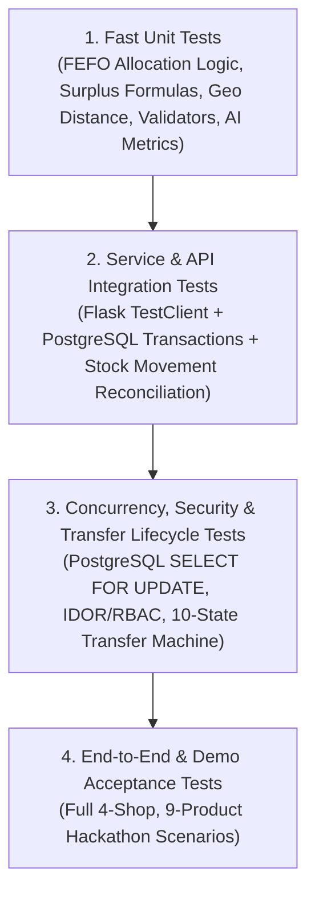

# Sanchay AI — Comprehensive Testing & QA Strategy

**Testing Framework:** `pytest`, `pytest-cov`  
**Database Target:** Isolated PostgreSQL test database (`sanchay_ai_test` via `TEST_DATABASE_URL`)  
**Core Rule (`RULE-07`, `RULE-20`):** All integration, concurrency, and workflow tests must run against **PostgreSQL** (never SQLite) so that `CHECK` constraints, `JSONB` columns, and `SELECT ... FOR UPDATE` row locks are genuinely verified.

---

## 1. Testing Pyramid & Architecture

---

## 2. Test Environment & Fixtures (`tests/conftest.py`)

1. **Isolated Test Database (`sanchay_ai_test`):**
   - Session-scoped fixture verifies `TEST_DATABASE_URL` points to a `_test` PostgreSQL database (refuses to run if pointed at `_dev` or `_prod`) and runs `flask db upgrade`.
   - Function-scoped fixture wraps each test or cleans tables via `TRUNCATE ... RESTART IDENTITY CASCADE` so tests are 100% deterministic and independent.
2. **Standard Test Fixtures:**
   - `org_fixture`: Active organization (`ORG-TEST-01`).
   - `shops_fixture`: 3 active shops (`Shop 1 — Andheri`, `Shop 2 — Bandra`, `Shop 3 — Powai`) + 1 `INACTIVE` shop (`Shop 4`).
   - `users_fixture`:
     - `super_admin_client` (`SUPER_ADMIN`)
     - `shop1_owner_client` (`SHOP_OWNER` assigned to Shop 1)
     - `shop2_owner_client` (`SHOP_OWNER` assigned to Shop 2)
   - `catalog_and_batches_fixture`: Perishable and non-perishable products with multiple batches (early expiry, later expiry, already expired, depleted).

---

## 3. Detailed Test Suites by Category

### 3.1 Phase 1 Foundation & Authentication Suite (`tests/test_phase1_auth.py` — VERIFIED)
- **Status:** `30 passed` against `sanchay_ai_test` on PostgreSQL 18.3 (`86%` overall coverage).
- **Verified Test Categories:**
  1. Application startup, environment configs, SQLite fallback prohibition, and production secret enforcement.
  2. PostgreSQL connectivity (`/api/v1/health`, `flask db-check`) and verification that only Phase 1 tables (`users`, `audit_logs`) exist.
  3. Alembic migration round-trip (`downgrade base` -> `upgrade head`).
  4. Successful login via HTML form and REST JSON API (username & case-insensitive email) and CLI `flask create-user`.
  5. Anti-enumeration login rejection (wrong password, unknown user, and deactivated user return identical `401 INVALID_CREDENTIALS`).
  6. `scrypt` password hashing, audit payload secret redaction, and password change workflow.
  7. Unauthenticated route protection (`302` redirect on HTML, `401` JSON on `/api/v1/auth/*`).
  8. Logout and server-side `session_token` rotation preventing captured cookie replay.
  9. CSRF token validation on form and JSON `POST` endpoints (`400 CSRF_TOKEN_MISSING_OR_INVALID`).
  10. Input validation, duplicate username/email (`409`), and open-redirect prevention.

### 3.1b Planned Unit Tests (`tests/unit/` — Phases 2–8)
- **FEFO Order & Depletion Math:** Verify batch sorting (`expiry_date ASC NULLS LAST, received_at ASC, id ASC`) and multi-batch split math.
- **Surplus & Recipient Scoring Formulas:** Verify 14-day velocity ($V_{s,p}$), days-to-expiry ($D_b$), projected unsold surplus quantity, and Haversine distance (`app/utils/geo.py`).
- **Financial & Wastage Formulas:** Verify Gross Revenue, COGS, Gross Profit, Cost vs. Retail Valuation, and Realized vs. Estimated Wastage Avoided (`BR-017`, `BR-018`).
- **Input Validators:** Verify decimal price rounding, quantity bounds, and date validation.

---

### 3.2 Phase 2 Organization, Shops & RBAC Isolation Suite (`tests/test_phase2_rbac_shops.py` — VERIFIED)
- **Status:** `19 passed` in `tests/test_phase2_rbac_shops.py` + `30 passed` in `tests/test_phase1_auth.py` (`49/49` total passing against `sanchay_ai_test`, `81%` overall coverage).
- **Verified Phase 2 Test Categories:**
  1. **Organization Creation & Editing:** `SUPER_ADMIN` creates/edits organization, duplicate code rejected (`409`), single-org binding per `SUPER_ADMIN`, non-admin rejected (`403 INSUFFICIENT_ROLE_PERMISSION`).
  2. **Shop Creation:** `SUPER_ADMIN` creates shops inheriting organization default low-stock and near-expiry thresholds, optional initial owner assignment (`owner_user_id`), and Haversine peer distance calculation (`app/utils/geo.py`).
  3. **Per-Organization Shop Code Uniqueness:** Duplicate shop `code` within the same organization returns `409 DUPLICATE_RESOURCE`, while an identical shop `code` in a separate organization succeeds.
  4. **Shop Editing & Status Changes:** Assigned `SHOP_OWNER` can edit operational contact/address/thresholds while shop is `ACTIVE`, but cannot alter `status` or `code` (`403`). `SUPER_ADMIN` transitions `status` between `ACTIVE`, `INACTIVE`, and `SUSPENDED`.
  5. **Deactivated Shop & Organization Operational Blocking:** Deactivating a shop (`INACTIVE`/`SUSPENDED`) or organization (`INACTIVE`) blocks operational actions (`/api/v1/shops/{id}/operational-check`, new assignments, shop creation) with `403 INACTIVE_SHOP` / `403 INACTIVE_ORGANIZATION` while preserving historical records.
  6. **Role Assignment & Primary Shop Uniqueness:** Enforces `SUPER_ADMIN`, `SHOP_OWNER`, and `STAFF` roles and PostgreSQL partial unique index `uq_user_active_primary_shop`.
  7. **Super Admin Scope:** Accesses and manages all shops and personnel within their authorized organization.
  8. **Shop Owner Scope:** Restricted to assigned shops; can create/manage only `STAFF` on owned shops; cannot create `SHOP_OWNER`/`SUPER_ADMIN` or new shops.
  9. **Staff Scope:** Restricted to viewing assigned shops; blocked from shop edits, user directories, user creation, and self-role elevation (`403`).
  10. **Unauthorized Access & Audit Logging:** Unauthenticated requests return `401` (API) / `302` (HTML); forbidden requests return `403` and persist immutable `UNAUTHORIZED_ORG_ACCESS`, `UNAUTHORIZED_SHOP_ACCESS`, and `INSUFFICIENT_ROLE_PERMISSION` records in `audit_logs`.
  11. **Cross-Shop IDOR Prevention:** `owner_a1` attempting to view, edit, or assign staff to `shop_a2` (same org, unassigned) is rejected with `403 UNAUTHORIZED_SHOP_ACCESS`.
  12. **Cross-Organization IDOR Prevention:** `admin_org_a` attempting to view, edit, or assign resources belonging to `org_b` / `shop_b1` is rejected with `403 UNAUTHORIZED_ORG_ACCESS`.

---

### 3.3 Phase 3 Product Catalog, Batch Inventory & Reconciliation Suite (`tests/test_phase3_inventory_batches.py` — VERIFIED)
- **Status:** `9 passed` in `tests/test_phase3_inventory_batches.py` + `19 passed` in `tests/test_phase2_rbac_shops.py` + `30 passed` in `tests/test_phase1_auth.py` (`58/58` total passing against `sanchay_ai_test`).
- **Verified Phase 3 Test Categories (Enforces `BR-001`, `BR-002`, `BR-003`, `BR-006`, `BR-007`):**
  1. **Product Catalog CRUD & Validation:** Create, view, edit, search, category/status filter, paginate, and soft-deactivate (`is_active=False`) products; reject destructive delete (`409 DESTRUCTIVE_DELETE_PROHIBITED`); enforce per-organization SKU uniqueness (`uq_products_org_sku`), cross-shop SKU enrollment, and strict price/unit/threshold validation (`selling_price >= default_purchase_price`).
  2. **Multi-Batch Inventory & FEFO Ordering:** Receive multiple batches per product with distinct expiry dates and purchase costs; verify deterministic FEFO ordering (`expiry_date ASC NULLS LAST, received_at ASC, id ASC`) and product stock aggregation (`available_qty`, `reserved_qty`, `damaged_qty`, `expired_qty`).
  3. **Ledger Reconciliation Assertion Helper (`assert_inventory_reconciled(shop_id)`):** Verifies at the end of every inventory mutation that all batch buckets are non-negative and `SUM(stock_movements.quantity_change WHERE batch_id=b AND bucket_affected=k) == current_bucket_qty`.
  4. **Automatic Expiry Quarantine, Near-Expiry & Low-Stock Rules:** Expired batches are automatically swept from `available_qty` into `expired_qty` (`MARK_EXPIRED` ledger entry, status `EXPIRED`); near-expiry batches within `0 <= days_to_expiry <= threshold` are flagged `NEAR_EXPIRY`; low-stock/out-of-stock status (`IN_STOCK`, `LOW_STOCK`, `OUT_OF_STOCK`) is computed solely from sellable `available_qty` (excluding expired and damaged buckets).
  5. **RBAC, Cross-Shop/Cross-Org Isolation & Concurrency Locking:** Verifies `STAFF` can receive batches (`201`) but cannot create/edit products or adjust batches (`403`), blocks cross-shop (`403 UNAUTHORIZED_SHOP_ACCESS`), cross-org (`403 UNAUTHORIZED_ORG_ACCESS`), deactivated shop (`403 INACTIVE_SHOP`), and deactivated product (`409 PRODUCT_INACTIVE`) mutations, and validates multi-threaded PostgreSQL `SELECT ... FOR UPDATE` row locking against negative stock.

---

### 3.4 POS Sales, FEFO & Returns Tests (`tests/test_phase4_sales_fefo.py` — VERIFIED)
- **Status:** `8 passed` in `tests/test_phase4_sales_fefo.py` + `9 passed` in `tests/test_phase3_inventory_batches.py` + `19 passed` in `tests/test_phase2_rbac_shops.py` + `30 passed` in `tests/test_phase1_auth.py` (`66/66` total passing against `sanchay_ai_test`, `82%` overall coverage).
- **Verified Phase 4 Test Categories (Enforces `BR-002`, `BR-004`, `BR-006`, `BR-007`, `BR-013`, `BR-017`, `OD-006`):**
  1. **Authoritative Pricing, Historical Price Preservation & Sequential Receipt Uniqueness:** Ignores forged client `unit_selling_price` / `total_amount` values; snapshots `ShopProduct.selling_price` and `InventoryBatch.unit_cost`; verifies subsequent product price edits do not alter historical invoices or receipts; verifies sequential unique `INV-{SHOP_CODE}-{YYYYMMDD}-{NNNN}` invoice numbers.
  2. **FEFO Multi-Batch Allocation & Non-Sellable Bucket Exclusion:** Quarantines past-expired batches (`MARK_EXPIRED` sweep), excludes `damaged_qty` and `reserved_qty`, and deducts requested quantity in strict `expiry_date ASC NULLS LAST, received_at ASC, id ASC` order across multiple batches with exact `SALE` stock movement ledger reconciliation.
  3. **Atomic Transaction Rollback, Duplicate Submission Guard & Multi-Threaded Concurrency:** Verifies simulated mid-checkout failure rolls back `sales`, `sale_items`, and batch deductions (`0` partial records); verifies duplicate `X-Idempotency-Key` / `idempotency_key` submissions return `409 DUPLICATE_SALE_SUBMISSION` without double-deducting stock; verifies 5 concurrent threads attempting to buy 4 units each from a 10-unit batch under PostgreSQL `SELECT ... FOR UPDATE` allow exactly 2 sales (`8` units sold, `2` remaining) and reject 3 with `409 INSUFFICIENT_SELLABLE_STOCK`.
  4. **Condition-Based Returns, Same-Day Cancellations & Net-of-Return Summaries:** Verifies `RESELLABLE`, `DAMAGED`, and `EXPIRED` returns route stock to the exact batch bucket (`AVAILABLE`, `DAMAGED`, `EXPIRED`), block over-returns (`409 RETURN_EXCEEDS_SOLD_QUANTITY`), enforce same-day cancellation (`SALE_CANCELLATION`), and verify gross vs. net revenue, COGS, gross profit, and unit summaries (`BR-017`).
  5. **RBAC, Cross-Shop/Cross-Org Isolation, Inactive Shop/Product Guards & HTML POS Views:** Verifies cross-shop (`403 UNAUTHORIZED_SHOP_ACCESS`), cross-org (`403 UNAUTHORIZED_ORG_ACCESS`), deactivated product (`409 PRODUCT_INACTIVE`), deactivated shop (`403 INACTIVE_SHOP`), destructive `DELETE` (`409 DESTRUCTIVE_DELETE_PROHIBITED`), and HTML POS checkout/history/receipt/return views.

---

### 3.5 Phase 5 Rule-Based Stock Analysis Tests (`tests/test_phase5_stock_analysis.py` — Implemented)
- **Status:** 7 comprehensive test functions covering all 15 deterministic analysis scenarios (`73/73` total tests passing across Phases 1–5; `92%` coverage on `app/services/surplus_service.py`; `84%` overall `app/` coverage):
  1. **Sales Velocity, Returns, Cancellations & Shop Isolation:** Verifies lookback window velocity (`net_units_sold / lookback_days`), exclusion of `CANCELLED` sales, deduction of returned units (`quantity - returned_quantity`), and strict isolation between shops.
  2. **Batch Expiry-Risk & FEFO Queue Awareness:** Verifies that earlier-expiring sellable batches absorb projected product demand first before later-expiring batches are evaluated (`CRITICAL`, `HIGH`, `MEDIUM`, `LOW`, `EXPIRED`, `NON_PERISHABLE`).
  3. **Excluded Stock & Surplus Retention Floor:** Verifies that `reserved_qty`, `damaged_qty`, and `expired_qty` (including past-due available stock) are excluded from sellable/surplus stock, that the shop always retains at least `max(reorder_threshold, safety_stock_qty)`, and that units are never double-counted across multiple batches.
  4. **Low-Stock Detection & Missing/Sparse History Safety:** Verifies `OUT_OF_STOCK` and `LOW_STOCK` deficit/replenishment math, and verifies that missing sales history (`NO_SALES_HISTORY`) is never treated as proof of zero demand (`potential_surplus_qty == 0`).
  5. **Read-Only Guarantee, Explanations, Deduplication & Stale Invalidation:** Verifies that running `StockAnalysisService.analyze_shop` produces zero mutations to `inventory_batches` or `stock_movements`, stamps recommendations with reasons/values/assumptions/`rule_version`/`analyzed_at`, deduplicates recommendations by `recommendation_key`, and invalidates/recalculates cached snapshots immediately after a sale, stock receipt, or stock adjustment (`DATA_CHANGED`).
  6. **RBAC Isolation, HTML Views & REST APIs:** Verifies `401` unauthenticated, `403` cross-shop/cross-org access, `400` invalid query params, `404` missing product/batch, and `200 OK` across all Phase 5 HTML pages and `/api/v1/shops/<id>/analysis/*` endpoints.
  7. **Overstock Coverage (`OVERSTOCK_COVERAGE`), Sparse History (`SPARSE_HISTORY`) & Safety Stock Overrides:** Verifies non-perishable overstock surplus calculation and explicit `safety_stock_qty` parameter overrides.

---

### 3.6 Inter-Store Transfer Lifecycle Tests (`tests/test_phase6_transfers.py` — VERIFIED)
- **Status:** `12 passed` in `tests/test_phase6_transfers.py` + `7 passed` in `tests/test_phase5_stock_analysis.py` + `8 passed` in `tests/test_phase4_sales_fefo.py` + `9 passed` in `tests/test_phase3_inventory_batches.py` + `19 passed` in `tests/test_phase2_rbac_shops.py` + `30 passed` in `tests/test_phase1_auth.py` (`85/85` total passing across Phases 1–6 against `sanchay_ai_test`).
- **Verified Phase 6 Test Categories (Enforces `BR-005`, `BR-008`, `BR-009`, `BR-010`, `BR-011`, `BR-012`, `BR-013`, `BR-016`):**
  1. **Eligible Recipient Discovery (`test_eligible_recipient_shops_listing`):** Enforces sister-shop discovery within the same organization, excludes self, and surfaces current stock & demand replenishment deficit indicators.
  2. **Source-Initiated Proposal (`test_transfer_proposal_creation_by_source_owner`):** Proposes transfer with `TRF-YYYYMMDD-XXXX` code, sets `PENDING_RECIPIENT_APPROVAL`, records initial timeline log, and validates open proposal quantity tracking.
  3. **Strict Validation & Guardrails (`test_proposal_validation_insufficient_stock_and_expired`):** Blocks offers on expired batches, past-due batches, negative/zero quantities, quantities exceeding available minus open pending commitments, self-transfers, and inactive sister shops.
  4. **Dual Approval & Row-Level Stock Reservation (`test_recipient_approval_reserves_stock_atomically`):** Recipient approval locks the source batch with `SELECT ... FOR UPDATE`, atomically shifts `available_qty -> reserved_qty`, writes `TRANSFER_RESERVE` ledger entry, and blocks unauthorized staff.
  5. **Recipient-Initiated Proposal (`test_recipient_initiated_proposal_and_source_approval`):** Recipient shop owner requests stock (`PENDING_SOURCE_APPROVAL`), requiring subsequent source owner approval to transition to `APPROVED_RESERVED`.
  6. **Rejection Lifecycle & Reservation Release (`test_rejection_workflow_and_reservation_release`):** Either party can reject before dispatch; if already reserved, unreserves stock atomically (`reserved_qty -> available_qty`, `TRANSFER_RELEASE`).
  7. **Cancellation Lifecycle & Reservation Release (`test_cancellation_workflow_and_reservation_release`):** Either party can cancel before dispatch; releases reserved units immediately (`reserved_qty -> available_qty`, `TRANSFER_RELEASE`).
  8. **Anti-Overselling Concurrency Protection (`test_stock_reservation_prevents_pos_overselling`):** Reserved stock cannot be sold at POS; POS checkouts respect `available_qty` and cleanly reject when reserved units leave insufficient balance.
  9. **Physical Dispatch Handover (`test_physical_dispatch_workflow`):** Source owner or authorized staff confirms physical dispatch (`DISPATCHED_IN_TRANSIT`); stock safely remains in source `reserved_qty` while in transit.
  10. **Atomic Receipt & Batch Expiry Preservation (`test_atomic_receipt_completion_and_expiry_preservation`):** Recipient owner confirms receipt (`COMPLETED`); in a single ACID transaction, deducts source `reserved_qty` (`TRANSFER_OUT`), creates/increments recipient batch (`TRANSFER_IN`), writes immutable stock movements, and strictly preserves the original batch code and expiry date.
  11. **Transit Damage Quarantine (`test_transit_damage_recording`):** When damaged units are reported on receipt, creates recipient batches in both `available_qty` (good) and `damaged_qty` (damaged) with appropriate `TRANSFER_IN` ledger audit records.
  12. **Network Surplus API & HTML Views (`test_network_surplus_and_html_views`):** Scoped sister shop surplus discovery (`/api/v1/shops/{id}/network-surplus-offers`), incoming/outgoing filters, and end-to-end rendering of list, creation, and detail HTML templates.

---

### 3.6 Concurrent Stock Mutation Tests (`tests/test_phase7_concurrency.py`)
Enforces `BR-006` and `NFR-002`:
- Uses Python `concurrent.futures.ThreadPoolExecutor` against real PostgreSQL connections (`sanchay_ai_test`):
  - **Scenario A (Concurrent POS Sales):** Batch has `10` units. 5 threads simultaneously attempt to buy `4` units each (`total = 20`). Exactly 2 threads succeed (`8` units sold, `2` remaining) and 3 threads receive `409 INSUFFICIENT_SELLABLE_STOCK`. Final `available_qty == 2` (never negative).
  - **Scenario B (Simultaneous POS Sale + Transfer Second-Owner Approval):** Batch has `15` units. Thread 1 submits a POS sale for `10` units while Thread 2 approves a transfer reserving `10` units. PostgreSQL `SELECT ... FOR UPDATE` serializes the two transactions: the first succeeds (`5` remaining) and the second cleanly fails with `409`.

---

### 3.7 In-App Notifications & Event Alerts Tests (`tests/test_phase7_notifications.py` — VERIFIED)
- **Status:** `12 passed` in `tests/test_phase7_notifications.py` + `12 passed` in `tests/test_phase6_transfers.py` + `7 passed` in `tests/test_phase5_stock_analysis.py` + `8 passed` in `tests/test_phase4_sales_fefo.py` + `9 passed` in `tests/test_phase3_inventory_batches.py` + `19 passed` in `tests/test_phase2_rbac_shops.py` + `30 passed` in `tests/test_phase1_auth.py` (`97/97` total passing across Phases 1–7 against local PostgreSQL local databases).
- **Verified Phase 7 Test Suite Matrix (Enforces `BR-015`, `FR-050` through `FR-054`):**
  1. **Notification Creation for Supported Events (`test_notification_creation_for_supported_events`):** Verifies deterministic in-app notification creation across low stock, near expiry, transfer proposals, approvals, rejections, cancellations, dispatches, and receipts.
  2. **Recipient Delivery & Shop Authorization (`test_correct_recipients_for_each_shop`):** Verifies event notifications deliver strictly to active users assigned to the affected shop (`SHOP_OWNER`, `STAFF`) and do not leak to unassigned users.
  3. **Unauthorized Notification Access Prevention (`test_unauthorized_notification_access_prevention`):** Verifies cross-user and cross-tenant isolation; unauthorized attempts to read or mark another user's notifications are rejected (`403 FORBIDDEN_NOTIFICATION_ACCESS`).
  4. **Unread Count Accuracy (`test_unread_count_accuracy`):** Verifies fast indexed count of unread notifications via both service layer and `/api/v1/notifications/unread-count`.
  5. **Mark-One-as-Read Behavior (`test_mark_one_as_read_behavior`):** Verifies atomic update of `is_read = True` and population of `read_at` timestamp.
  6. **Mark-All-as-Read Behavior (`test_mark_all_as_read_behavior`):** Verifies batch marking of all unread notifications for the authenticated user via `/api/v1/notifications/read-all`.
  7. **Pagination and Category/Status Filtering (`test_pagination_and_filtering`):** Verifies `is_read` (`all`, `unread`, `read`), `type`, and pagination metadata (`page`, `per_page`, `total_pages`, `total_items`).
  8. **Event Deduplication Handling (`test_duplicate_event_handling`):** Enforces `uq_notifications_user_dedup` unique constraint, ensuring duplicate events with identical dedup keys return the existing record without duplicate insertions.
  9. **Atomic Transaction Rollback (`test_failed_transactions_do_not_produce_success_notifications`):** Verifies that business transaction failures (e.g. transfer validation or stock check failures) roll back atomically, persisting `0` notifications.
  10. **Expiry and Low-Stock Alert Deduplication (`test_expiry_and_low_stock_alert_deduplication`):** Verifies daily deduplication of batch expiry and low-stock checks (`check_and_notify_inventory_alerts`).
  11. **Inter-Store Transfer Lifecycle Integration (`test_transfer_lifecycle_notification_integration`):** Verifies end-to-end in-transaction notification triggers across proposal, dual approval, dispatch, and physical completion.
  12. **Notification Center UI, Bell Badge & On-Demand Alerts (`test_html_views_and_bell_badge`):** Verifies `/notifications` page rendering, navbar bell badge, filter forms, and `/api/v1/shops/{id}/inventory/check-alerts` API.

---

### 3.8 Dashboards, Operational Analytics & Reports Tests (`tests/test_phase8_reports_dashboards.py` — VERIFIED)
- **Status:** `14 passed, 0 failed` in `tests/test_phase8_reports_dashboards.py` (`111/111` total passing across Phases 1–8 against local PostgreSQL `sanchay_ai_test`).
- **Verified Phase 8 Test Suite Matrix (Enforces `FR-055` through `FR-060`):**
  1. **Super Admin Dashboard Metrics (`test_super_admin_dashboard_metrics`):** Verifies organization-wide network aggregation: total/active shop counts, distinct products, stock unit counts, total inventory valuation, gross sales revenue, COGS, gross profit margins, completed/pending transfers, near-expiry batch counts, at-risk valuation, and shop-by-shop breakdown.
  2. **Organization Summary API (`test_api_organization_summary_endpoint`):** Tests authenticated endpoint `GET /api/v1/reports/organization/summary` (`API-039`), verifying JSON payload structure, numeric precision, and strict `SUPER_ADMIN` role restriction (`403` for non-admins).
  3. **Shop Owner Dashboard Metrics (`test_shop_owner_dashboard_metrics`):** Verifies shop-scoped operational metrics: sellable vs. reserved vs. damaged/expired units, retail vs. cost valuation, sales volume, profit margins, transfer incoming/outgoing pipeline, actionable low-stock items, and near-expiry FEFO batches.
  4. **Strict Shop-Level Isolation Enforcement (`test_shop_level_isolation_enforcement`):** Verifies that a Shop Owner attempting to query analytics or summaries for an unassigned sister shop is blocked with `403 UNAUTHORIZED_SHOP_ACCESS`.
  5. **Continuous Sales Trends (`test_sales_trends_daily_and_monthly`):** Verifies daily and monthly time-series aggregation with continuous zero-filling, ensuring days with no sales return `0.0` revenue and `0` orders rather than missing dates.
  6. **Trends API Endpoint (`test_api_analytics_trends_endpoint`):** Tests `GET /api/v1/reports/analytics/trends` with `days`, `group_by`, and `shop_id` query parameters.
  7. **Top-Selling Products (`test_top_selling_products`):** Verifies ranking of products by quantity volume and revenue, date filtering, and product metadata.
  8. **Stock Distribution Analytics (`test_stock_distribution`):** Verifies multi-dimensional stock categorization: by product category, by batch status (`ACTIVE`, `EXPIRED`, `DEPLETED`), and by expiry risk horizons (`< 7 days`, `7-30 days`, `> 30 days`).
  9. **Transfer Activity Analytics (`test_transfer_activity`):** Verifies transfer metrics: completed, pending, rejected, cancelled, transit volume, and partner exchange activity.
  10. **Report Generation Types (`test_generate_report_types`):** Verifies report generation across all 4 report types (`SALES`, `INVENTORY`, `NEAR_EXPIRY`, `TRANSFERS`) with category filtering and summary statistics.
  11. **Date Range Validation (`test_date_range_validation_errors`):** Verifies strict validation rules: invalid date formats return `400 INVALID_PARAMETER`, and `start_date > end_date` returns `400 INVALID_DATE_RANGE`.
  12. **Streaming RFC 4180 CSV Export (`test_csv_export_streaming`):** Tests `GET /api/v1/reports/export` (`API-040`), verifying HTTP headers (`text/csv`, `attachment; filename=...`), CSV column headers, and data rows formatted according to RFC 4180.
  13. **Empty Dataset Handling (`test_empty_shop_graceful_handling`):** Verifies graceful zero-handling when querying a freshly created shop with zero inventory, sales, or transfers.
  14. **HTML Dashboard & Reports Hub Rendering (`test_html_dashboard_and_reports_pages`):** Verifies end-to-end rendering of `/dashboard`, `/reports`, `/analytics` redirect, SVG charts container, and CSV export buttons for both Super Admin and Shop Owner roles.

---

### 3.9 AI Demand Forecasting & Predictive Stockout Tests (`tests/test_ai_demand_forecasting.py` — VERIFIED)
- **Status:** `6 passed, 0 failed` in `tests/test_ai_demand_forecasting.py`.
- **Test Matrix (PRD Module G & `FR-061` to `FR-065`):**
  1. `test_ai_demand_forecasting_ridge_regression_with_seasonality`: Verifies Scikit-Learn Ridge regression fitting on historical sales, calendar seasonality (day-of-week one-hot encoding), linear trend, confidence intervals (`lower_ci_90`, `upper_ci_90`), and forecast horizons (7d, 14d, 30d).
  2. `test_ai_demand_forecasting_sparse_data_graceful_fallbacks`: Verifies tiered fallbacks: Ridge regression for $\ge 14$ days, EWMA for 3–13 days, moving average baseline for $< 3$ days.
  3. `test_days_of_inventory_and_stockout_prediction`: Verifies Days of Inventory (DOI) calculations and predicted calendar stockout dates based on current available sellable inventory.
  4. `test_poisson_survival_spoilage_modeling`: Verifies Poisson cumulative survival probabilities modeling the chance of batches expiring before customer demand depletes them.
  5. `test_product_analysis_api_forecast_endpoint`: Verifies JSON API endpoint `GET /api/v1/shops/{shop_id}/products/{product_id}/forecast` with model metrics and Poisson curves.
  6. `test_read_only_ai_guarantee_zero_mutations`: Verifies that querying AI demand projections executes zero database mutations on `inventory_batches`, `stock_movements`, or `sales`.

---

### 3.10 Expiry Risk & Waste Mitigation ML Engine Tests (`tests/test_waste_mitigation_engine.py` — VERIFIED)
- **Status:** `3 passed, 0 failed` in `tests/test_waste_mitigation_engine.py`.
- **Test Matrix:**
  1. `test_waste_mitigation_analysis_computes_salvage_and_waste`: Verifies computation of at-risk capital, projected waste losses vs potential salvage value, and prioritized mitigation action recommendations.
  2. `test_waste_mitigation_html_and_api_endpoints`: Verifies both HTML interface (`/shops/{shop_id}/waste-mitigation`) and JSON API (`/api/v1/shops/{shop_id}/waste-mitigation`).
  3. `test_waste_mitigation_access_control`: Verifies strict 2-role authorization (`SUPER_ADMIN` and assigned `SHOP_OWNER`) and cross-shop isolation (`403 Forbidden`).

---

### 3.11 Offline POS Queue & Bill Reconciliation Tests (`tests/test_offline_pos_reconciliation.py` — VERIFIED)
- **Status:** `3 passed, 0 failed` in `tests/test_offline_pos_reconciliation.py`.
- **Test Matrix (PRD Module D & `FR-036`):**
  1. `test_offline_reconciliation_happy_path_and_deduplication`: Verifies sequential batch processing, FEFO inventory decrement, sales record persistence, and idempotent deduplication (`ALREADY_SYNCED`) on retry.
  2. `test_offline_reconciliation_conflict_isolation`: Verifies that a stockout on bill #2 does not crash or abort bill #1; returns `CONFLICT_INSUFFICIENT_STOCK` with atomic per-bill rollback.
  3. `test_offline_reconciliation_authorization`: Verifies unassigned shop owners cannot sync bills to other stores (`403 UNAUTHORIZED_SHOP_ACCESS`).

---

### 3.12 Thermal Slip & Tax Invoicing Tests (`tests/test_invoicing_thermal_slip.py` — VERIFIED)
- **Status:** `3 passed, 0 failed` in `tests/test_invoicing_thermal_slip.py`.
- **Test Matrix (PRD Module D & `FR-031`):**
  1. `test_thermal_slip_generation_80mm_and_58mm`: Verifies ESC/POS monospaced receipt formatting, layout switching (`width=58`), auto-print trigger (`autoprint=1`), and batch tracking codes.
  2. `test_tax_invoice_a4_generation`: Verifies formal A4 Tax Invoice layout with GST breakdown, terms and conditions, and authorized signature sections.
  3. `test_invoicing_endpoints_access_control`: Verifies access control and shop isolation across printable endpoints.

---

### 3.13 Inter-Store Redistribution Recommendation Tests (`tests/test_redistribution_recommendations.py` — VERIFIED)
- **Status:** `3 passed, 0 failed` in `tests/test_redistribution_recommendations.py`.
- **Test Matrix (PRD Module F & `FR-050`):**
  1. `test_redistribution_recommendations_pairs_surplus_with_deficit`: Verifies cross-shop surplus matching with stockout shops, Haversine distance and transit cost estimation, and net salvage margin prioritization.
  2. `test_redistribution_recommendations_html_and_api`: Verifies HTML board and JSON endpoint `GET /api/v1/shops/{shop_id}/transfers/redistribution-recommendations`.
  3. `test_redistribution_recommendations_isolation_and_zero_mutations`: Verifies tenant isolation and strict read-only AI guarantee (zero automated transfer submissions).

---

### 3.14 Master Test Suite Execution Summary
- **Total Automated Tests:** 132 tests across 14 test modules.
- **Pass Rate:** 100% (`132 passed, 0 failed` in 174.32s).
- **Database Engine:** PostgreSQL 18.3 local database (`sanchay_ai_test`).
