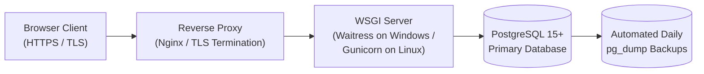

# Sanchay AI — Deployment, Backup & Operations Guide

This guide specifies how to deploy, operate, back up, and recover **Sanchay AI** across Local Demo, Staging, and Production environments.

---

## 1. Deployment Architecture Overview

Sanchay AI is a stateless WSGI Python web application backed by a stateful **PostgreSQL 15+** database (`ADR-001`, `ADR-002`).

- **Windows Server / Local Hackathon Host:** Run via **Waitress** (`waitress-serve`), a production-quality pure-Python WSGI server with native Windows support.
- **Linux Staging / Production Host:** Run via **Gunicorn** behind an **Nginx** reverse proxy with TLS termination (`HTTPS`).



---

## 2. Production Environment Configuration Checklist

Before starting the server in a staging or production environment, verify the following environment variables:

| Variable | Required Production Setting | Security Rationale |
| :--- | :--- | :--- |
| `FLASK_ENV` | `production` | Disables interactive debugger and development overrides. |
| `FLASK_DEBUG` | `0` | Prevents arbitrary code execution via Werkzeug debugger. |
| `SECRET_KEY` | Unique 64-char cryptographically random hex string | Signs session cookies and CSRF tokens (`RULE-21`). |
| `SESSION_COOKIE_SECURE` | `true` (when served over HTTPS) | Ensures session cookies are transmitted only over encrypted TLS. |
| `SESSION_COOKIE_HTTPONLY` | `true` | Prevents client-side JS access to session cookies. |
| `SESSION_COOKIE_SAMESITE` | `Lax` | Mitigates cross-site request forgery. |
| `WTF_CSRF_ENABLED` | `true` | Enforces CSRF protection on all state-changing endpoints. |
| `DATABASE_URL` | Least-privilege PostgreSQL user (`sanchay_app_user`) | Avoids running the web app as PostgreSQL `postgres` superuser. |

---

## 3. Starting the Production WSGI Server

### 3.1 On Windows (Using `waitress`)
```powershell
# Activate virtual environment
.\.venv\Scripts\Activate.ps1

# Apply database migrations first
python -m flask db upgrade

# Start Waitress WSGI server with 4 worker threads
waitress-serve --host=127.0.0.1 --port=8000 --threads=4 wsgi:app
```

### 3.2 On Linux (Using `gunicorn`)
```bash
source .venv/bin/activate
python -m flask db upgrade
gunicorn --bind 127.0.0.1:8000 --workers 4 --threads 2 --timeout 60 wsgi:app
```

---

## 4. Database Backup, Restore & Migration Rollback Procedures

### 4.1 Pre-Migration & Daily Backup (`pg_dump`)
Always take a compressed custom-format PostgreSQL dump before running schema migrations or major data operations:

```powershell
# Windows PowerShell backup command
$Timestamp = Get-Date -Format "yyyyMMdd_HHmmss"
pg_dump -U postgres -h localhost -Fc sanchay_ai_dev -f "backups/sanchay_ai_$Timestamp.dump"
```

### 4.2 Database Restore (`pg_restore`)
To restore from a verified backup file:

```powershell
pg_restore -U postgres -h localhost --clean --if-exists -d sanchay_ai_dev "backups/sanchay_ai_20261012_180000.dump"
```

### 4.3 Safe Migration Rollback
If a deployment requires reverting the latest schema change:

```powershell
python -m flask db downgrade -1
```

---

## 5. Health Check & Operational Monitoring

- **Health Endpoint (`GET /api/v1/health` — Phase 1):**
  Executes a lightweight `SELECT 1` query against PostgreSQL and returns:
  - `200 OK`: `{"status": "healthy", "database": "connected", "ai_enabled": false}`
  - `503 Service Unavailable`: `{"status": "unhealthy", "database": "disconnected"}`
- **Application Logs:** Written with rotation (`RotatingFileHandler`, max `10 MB` per file, `5` backups) to `logs/sanchay_ai.log`.
