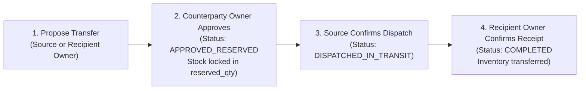

# Sanchay AI — Shop Owner & Staff User Guide

**Target Audience:** `SHOP_OWNER` (Store Managers/Owners) and `STAFF` (Cashiers & Inventory Clerks)  
**Status:** Phases 1–6 Implemented & Verified; Phases 7–8 Planned

---

## 1. Role Summary at Your Shop

| Capability | `SHOP_OWNER` | `STAFF` |
| :--- | :---: | :---: |
| Log in & view assigned shop dashboard | Yes | Yes |
| Add/edit products, prices, and alert thresholds | **Yes** | No (Read-only) |
| Receive new delivery batches (`RECEIPT`) | **Yes** | **Yes** |
| Perform manual stock adjustments (`ADJUSTMENT`, `MARK_DAMAGED`) | **Yes** | No |
| Run Point-of-Sale (POS) billing & print invoices | **Yes** | **Yes** |
| Process customer returns (`RESELLABLE` / `DAMAGED` / `EXPIRED`) | **Yes** | **Yes** |
| View deterministic Stock Analysis, Expiry Risk, Surplus & Recommendations | **Yes** | **Yes** |
| Propose, **Approve**, or **Reject** inter-store stock transfers (Phase 6) | **Yes (Exclusive)** | No |
| Record physical dispatch of an approved transfer (Phase 6) | **Yes** | **Yes** |
| **Confirm physical receipt** of incoming transfer (`COMPLETED` — Phase 6) | **Yes (Exclusive)** | No |

---

## 2. Managing Products & Batch-Level Inventory (Phase 3 — Implemented & Verified)

### 2.1 Adding a Product to Your Shop Catalog
1. Navigate to **Catalog -> Products** and click **+ Add Product**.
2. Enter the **SKU** (e.g., `SKU-DAIRY-PANEER-200G`), **Product Name**, **Category**, **Unit** (`pcs`, `pack`, `kg`, `litre`), **Purchase Price**, **Selling Price**, and check **Perishable** if the item has an expiry date.
3. Configure your shop's alert thresholds:
   - **Low-Stock Threshold** (e.g., `10` units)
   - **Near-Expiry Warning Window** (e.g., `15` days)
   - **Surplus Threshold** (e.g., `40` units)

> **Note (`RULE-05`):** All product and batch entries are entered manually via the web interface. Barcode/QR scanning and camera/OCR entry are not used.

### 2.2 Receiving a New Inventory Batch
Physical stock is always tracked by batch (`BR-001`):
1. Navigate to **Inventory -> Batches** and click **+ Receive Batch**.
2. Select the **Product**, enter the **Batch Code** printed on the supplier carton (e.g., `BATCH-PNR-202610-A`), **Manufactured Date**, **Expiry Date** (required for perishables), **Unit Purchase Cost**, and **Initial Quantity**.
3. Click **Save Receipt**. Your shop's sellable stock increases immediately and a `RECEIPT` entry is logged in **Stock Movements**.

### 2.3 Recording Damaged Stock or Cycle-Count Adjustments (`SHOP_OWNER` Only)
1. Locate the batch in **Inventory -> Batches** and click **Adjust Stock**.
2. Choose the adjustment type:
   - `MARK_DAMAGED`: Moves damaged units out of `available_qty` into `damaged_qty` so cashiers cannot accidentally sell them.
   - `ADJUSTMENT_ADD` / `ADJUSTMENT_SUBTRACT`: Corrects physical count discrepancies.
3. Enter the quantity and a **mandatory reason** (e.g., `"2 packs punctured during shelf restocking"`).

---

## 3. Point-of-Sale (POS) Billing & FEFO Deduction (Phase 4 — Implemented & Verified)

### 3.1 Creating a Customer Bill
1. Open **POS Counter** (`/pos` or `/shops/<id>/pos`) from the top navigation bar.
2. Search for active products by name, SKU, or category filter and click **+ Add to Cart**, then adjust quantities as needed.
3. Select the payment mode (`CASH`, `UPI_MANUAL`, `CARD_MANUAL`, `OTHER`), optionally enter an approved discount or customer name/phone, and click **Complete Sale & Generate Receipt**.
4. **Automatic FEFO Deduction (`BR-004`):**
   - Sanchay AI automatically deducts units from your **earliest-expiring active batch first** (First Expired, First Out).
   - If a customer buys `12` units and your earliest batch only has `8` units left, the invoice automatically splits the deduction (`8` units from the older batch + `4` units from the next batch) and prints the exact batch codes on the invoice/receipt so the cashier knows which packs to hand over.

### 3.2 Handling Cancellations & Returns
- **Same-Day Invoice Cancellation:** Open **Sales History** (`/sales` or `/shops/<id>/sales`), select today's invoice (with zero prior returns), click **Cancel Same-Day Invoice**, and provide a reason. All deducted units are restored to their original batches (`SALE_CANCELLATION`).
- **Item Returns:** Open the invoice detail view (`/shops/<id>/sales/<sale_id>`), select the batch allocation line item, specify the returned quantity and reason, and select the condition:
  - `RESELLABLE`: Restores units to the batch's `available_qty` (or `expired_qty` if the batch has expired since the sale).
  - `DAMAGED`: Records the returned units in `damaged_qty`.
  - `EXPIRED`: Records the returned units in `expired_qty`.

---

## 4. Rule-Based Stock Analysis & Risk Insights (Phase 5 — Implemented & Verified)

1. Open **Stock Analysis** (`/analysis` or `/shops/<id>/analysis`) from the top navigation bar.
2. **Adjust Deterministic Analysis Parameters:**
   - **Sales Lookback Window (`lookback_days`, default `14` days):** Computes historical daily sales velocity from non-cancelled POS sales minus item returns.
   - **Safety Stock Buffer (`safety_stock_days`, default `2` days, or explicit `safety_stock_qty` override):** Ensures your shop always retains at least `max(reorder_threshold, safety_stock_qty)` before any stock is flagged as surplus.
3. **Explore Specialized Analysis Tabs:**
   - **Risk Overview (`/shops/<id>/analysis`):** Summary KPIs, top near-expiry batches, top surplus candidates, product velocity table, and active recommendations.
   - **Expiry Risk (`/shops/<id>/analysis/expiry-risk`):** FEFO-ordered batch evaluation showing days to expiry, earlier FEFO stock, estimated batch demand before expiry, and projected unsold units.
   - **Potential Surplus (`/shops/<id>/analysis/surplus`):** Identifies transferable surplus units (`NEAR_EXPIRY_SURPLUS` and `OVERSTOCK_COVERAGE`) without double-counting across batches and without mutating stock.
   - **Low Stock (`/shops/<id>/analysis/low-stock`):** Flags `OUT_OF_STOCK`, `LOW_STOCK`, and `BELOW_SAFETY_STOCK` items with deficit and recommended replenishment quantities.
   - **Recommendations (`/shops/<id>/analysis/recommendations`):** Displays deduplicated, explainable recommendations stamped with database values, calculation assumptions, `rule_version`, and `analyzed_at`.

---

## 5. Inter-Store Stock Exchange Workflow (Phase 6 — Implemented & Verified)

When your shop has surplus or near-expiry stock—or when you are running low on a high-demand product—use the **Inter-Store Stock Exchange**:

### 5.1 Step-by-Step Transfer Execution
1. **Discover Surplus & Eligible Sister Shops:**
   - Open **Transfers -> Surplus Matchmaker**.
   - Review batches flagged as near-expiry or overstock alongside ranked eligible recipient shops (showing recipient stock need, distance in km, and estimated transport cost).
2. **Propose a Transfer Offer (`SHOP_OWNER`):**
   - Click **Propose Transfer**, choose the recipient shop, verify the quantity and transfer unit price, and submit.
3. **Dual Approval & Automatic Reservation (`BR-008`):**
   - Both the **Source Shop Owner** and the **Recipient Shop Owner** must approve the transfer.
   - As soon as the second Shop Owner clicks **Approve**, status changes to `APPROVED_RESERVED` and the units move from `available_qty` to `reserved_qty` in the source shop so they cannot be sold locally or offered to another shop.
4. **Physical Dispatch (`DISPATCHED_IN_TRANSIT`):**
   - After packing and handing over the goods to the courier/driver, the Source Shop clicks **Confirm Physical Dispatch** and records transport details.
5. **Physical Receipt Confirmation (`COMPLETED` — `BR-009`):**
   - When the shipment arrives at the recipient shop, the **Recipient Shop Owner** inspects the goods and clicks **Confirm Physical Receipt**.
   - Only at this moment does Sanchay AI deduct `reserved_qty` from the source shop and add the batch to the recipient shop's sellable inventory.
6. **Rejections, Cancellations & Disputes:**
   - Either Shop Owner may **Reject** or **Cancel** a transfer *before* physical dispatch, which immediately releases reserved stock back to `available_qty`.
   - If a dispatched transfer does not arrive or has transit damage, click **Report Dispute** (`DISPUTED`) to alert the Organization Super Admin and freeze the reservation until resolved.

---

## 6. Notifications & Alert Center (Phase 7 — Implemented & Verified)

Stay informed on critical store events, low-stock conditions, expiring batches, and transfer lifecycle events:

### 6.1 Navbar Bell & Unread Badge
- The top navigation bar includes a live **Bell Icon** and unread counter badge.
- Automatically polls every 45 seconds in the background without needing a page refresh or external socket servers.
- Displays the exact count of unread notifications for your account across your authorized shops.

### 6.2 Notification Center (`/notifications`)
- Access the centralized Notification Center by clicking the navbar bell or the **Alerts** link.
- **Filter Bar:** Filter notifications by read status (`All`, `Unread Only`, `Read Only`) or event category (`Low Stock`, `Near Expiry`, `Critical Expiry Risk`, `Surplus Available`, `Transfer Offers`, `Transfer Approvals`, `Transit Updates`, `Completions`).
- **Mark as Read:** Click **Mark as Read** on individual notification cards, or click **Mark All as Read** in the header to clear your unread backlog.
- **On-Demand Alert Evaluation:** Click **Evaluate Shop Alerts** to trigger an immediate scan of your active store's catalog and batch inventory. Newly detected low stock or near-expiry batches are flagged immediately with daily deduplication.
- **Direct Entity Actions:** Click **View Transfer &rarr;**, **View Product &rarr;**, or **View Batch Ledger &rarr;** on any notification card to jump directly to the relevant record.

