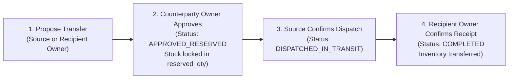

# Sanchay AI — Shop Owner User & Operations Guide

**Target Audience:** `SHOP_OWNER` (Store Owners & Managers)  
**Status:** Production-Ready (`132/132` Tests Passing)  
**Security Model:** Strict 2-Role RBAC (`SUPER_ADMIN` and `SHOP_OWNER`)

---

## 1. Shop Owner Operational Responsibilities

Under the strict 2-role architecture, the **`SHOP_OWNER`** possesses full operational control over assigned stores:

| Operational Area | Capabilities |
| :--- | :--- |
| **Catalog & Pricing** | Add/edit products, manage shop-specific selling/cost prices, and configure alert thresholds (`low_stock_threshold`, `near_expiry_days`). |
| **Batch Inwarding & Reconciliation** | Inward supplier batches with manufacture/expiry dates, track available vs. reserved units, and view immutable `stock_movements`. |
| **Manual Stock Adjustments** | Mark damaged units (`MARK_DAMAGED`) or record cycle count discrepancies with mandatory audit reasons. |
| **POS Billing & Invoicing** | High-speed FEFO counter checkout, line/bill discounts, offline queue auto-reconciliation, ESC/POS thermal slips (80mm/58mm), and formal A4 tax invoices. |
| **AI Stock & Waste Intelligence** | Scikit-Learn demand forecasting, Poisson survival spoilage probability, and actionable salvage recommendations. |
| **Inter-Store Stock Exchange** | Discover surplus, evaluate automated redistribution recommendations, execute dual-approval transfers, and confirm physical dispatch & receipt. |

---

## 2. Managing Products & Batch-Level Inventory (Phase 3 — Implemented & Verified)

### 2.1 Adding a Product to Your Shop Catalog
1. Navigate to **Catalog -> Products** and click **+ Add Product**.
2. Enter the **SKU** (e.g., `SKU-DAIRY-PANEER-200G`), **Product Name**, **Category**, **Unit** (`pcs`, `pack`, `kg`, `litre`), **Purchase Price**, **Selling Price**, and check **Perishable** if the item has an expiry date.
3. Configure your shop's alert thresholds:
   - **Low-Stock Threshold** (e.g., `10` units)
   - **Near-Expiry Warning Window** (e.g., `15` days)
   - **Surplus Threshold** (e.g., `40` units)

> **Note (`RULE-05`):** All product and batch entries are entered manually via the web interface. Barcode/QR scanning and camera/OCR entry are not used.

### 2.2 Receiving a New Inventory Batch
Physical stock is always tracked by batch (`BR-001`):
1. Navigate to **Inventory -> Batches** and click **+ Receive Batch**.
2. Select the **Product**, enter the **Batch Code** printed on the supplier carton (e.g., `BATCH-PNR-202610-A`), **Manufactured Date**, **Expiry Date** (required for perishables), **Unit Purchase Cost**, and **Initial Quantity**.
3. Click **Save Receipt**. Your shop's sellable stock increases immediately and a `RECEIPT` entry is logged in **Stock Movements**.

### 2.3 Recording Damaged Stock or Cycle-Count Adjustments (`SHOP_OWNER` Only)
1. Locate the batch in **Inventory -> Batches** and click **Adjust Stock**.
2. Choose the adjustment type:
   - `MARK_DAMAGED`: Moves damaged units out of `available_qty` into `damaged_qty` so cashiers cannot accidentally sell them.
   - `ADJUSTMENT_ADD` / `ADJUSTMENT_SUBTRACT`: Corrects physical count discrepancies.
3. Enter the quantity and a **mandatory reason** (e.g., `"2 packs punctured during shelf restocking"`).

---

## 3. Point-of-Sale (POS) Billing & FEFO Deduction (Phase 4 — Implemented & Verified)

### 3.1 Creating a Customer Bill
1. Open **POS Counter** (`/pos` or `/shops/<id>/pos`) from the top navigation bar.
2. Search for active products by name, SKU, or category filter and click **+ Add to Cart**, then adjust quantities as needed.
3. Select the payment mode (`CASH`, `UPI_MANUAL`, `CARD_MANUAL`, `OTHER`), optionally enter an approved discount or customer name/phone, and click **Complete Sale & Generate Receipt**.
4. **Automatic FEFO Deduction (`BR-004`):**
   - Sanchay AI automatically deducts units from your **earliest-expiring active batch first** (First Expired, First Out).
   - If a customer buys `12` units and your earliest batch only has `8` units left, the invoice automatically splits the deduction (`8` units from the older batch + `4` units from the next batch) and prints the exact batch codes on the invoice/receipt so the cashier knows which packs to hand over.

### 3.2 Handling Cancellations & Returns
- **Same-Day Invoice Cancellation:** Open **Sales History** (`/sales` or `/shops/<id>/sales`), select today's invoice (with zero prior returns), click **Cancel Same-Day Invoice**, and provide a reason. All deducted units are restored to their original batches (`SALE_CANCELLATION`).
- **Item Returns:** Open the invoice detail view (`/shops/<id>/sales/<sale_id>`), select the batch allocation line item, specify the returned quantity and reason, and select the condition:
  - `RESELLABLE`: Restores units to the batch's `available_qty` (or `expired_qty` if the batch has expired since the sale).
  - `DAMAGED`: Records the returned units in `damaged_qty`.
  - `EXPIRED`: Records the returned units in `expired_qty`.

### 3.3 Offline POS Counter Queue & Reconciliation
When store internet disconnects during active billing:
1. The POS counter queues bills locally with a client-generated unique `client_bill_id` (UUID).
2. As soon as connectivity restores, click **Sync Offline Queue** or allow automatic background sync to `/api/v1/shops/<id>/sales/offline-reconcile`.
3. **Idempotent Reconciliation:** Each bill is processed sequentially in FEFO order. Already-synced bills are recognized (`ALREADY_SYNCED`) and return the existing invoice without duplicate inventory deductions.
4. **Stockout Isolation:** If a queued bill fails due to insufficient stock, only that specific bill is marked `CONFLICT_INSUFFICIENT_STOCK` with atomic rollback; valid bills in the batch are committed successfully.

### 3.4 Printable Invoices: Thermal Slips & A4 Tax Invoices
Every completed sale supports multi-format printing:
- **Receipt Slip (`/shops/<id>/sales/<id>/receipt`):** Clean digital customer bill preview.
- **ESC/POS Thermal Slip (`/shops/<id>/sales/<id>/thermal-slip`):** Compact monospace slip optimized for standard thermal receipt printers (supports 80mm and 58mm layouts via `?width=58`, and optional auto-print trigger with `?autoprint=1`).
- **Formal A4 Tax Invoice (`/shops/<id>/sales/<id>/tax-invoice`):** Full-page invoice complete with store header, customer details, tax rates, payment mode, terms and conditions, and authorized signatory block suitable for PDF export and commercial filing.

---

## 4. Rule-Based Stock Analysis & Risk Insights (Phase 5 — Implemented & Verified)

1. Open **Stock Analysis** (`/analysis` or `/shops/<id>/analysis`) from the top navigation bar.
2. **Adjust Deterministic Analysis Parameters:**
   - **Sales Lookback Window (`lookback_days`, default `14` days):** Computes historical daily sales velocity from non-cancelled POS sales minus item returns.
   - **Safety Stock Buffer (`safety_stock_days`, default `2` days, or explicit `safety_stock_qty` override):** Ensures your shop always retains at least `max(reorder_threshold, safety_stock_qty)` before any stock is flagged as surplus.
3. **Explore Specialized Analysis Tabs:**
   - **Risk Overview (`/shops/<id>/analysis`):** Summary KPIs, top near-expiry batches, top surplus candidates, product velocity table, and active recommendations.
   - **Expiry Risk (`/shops/<id>/analysis/expiry-risk`):** FEFO-ordered batch evaluation showing days to expiry, earlier FEFO stock, estimated batch demand before expiry, and projected unsold units.
   - **Potential Surplus (`/shops/<id>/analysis/surplus`):** Identifies transferable surplus units (`NEAR_EXPIRY_SURPLUS` and `OVERSTOCK_COVERAGE`) without double-counting across batches and without mutating stock.
   - **Low Stock (`/shops/<id>/analysis/low-stock`):** Flags `OUT_OF_STOCK`, `LOW_STOCK`, and `BELOW_SAFETY_STOCK` items with deficit and recommended replenishment quantities.
    - **Recommendations (`/shops/<id>/analysis/recommendations`):** Displays deduplicated, explainable recommendations stamped with database values, calculation assumptions, `rule_version`, and `analyzed_at`.
    - **AI Waste Mitigation (`/shops/<id>/waste-mitigation`):** Evaluates near-expiry batches using Poisson cumulative survival models, computing exact probabilities of expiry before sale, salvage value vs. write-off loss, and recommending targeted mitigation strategies.

---

## 5. Inter-Store Stock Exchange Workflow (Phase 6 — Implemented & Verified)

When your shop has surplus or near-expiry stock—or when you are running low on a high-demand product—use the **Inter-Store Stock Exchange**:

### 5.1 Step-by-Step Transfer Execution
1. **Discover Surplus & Eligible Sister Shops:**
   - Open **Transfers -> Surplus Matchmaker**.
   - Review batches flagged as near-expiry or overstock alongside ranked eligible recipient shops (showing recipient stock need, distance in km, and estimated transport cost).
2. **Propose a Transfer Offer (`SHOP_OWNER`):**
   - Click **Propose Transfer**, choose the recipient shop, verify the quantity and transfer unit price, and submit.
3. **Dual Approval & Automatic Reservation (`BR-008`):**
   - Both the **Source Shop Owner** and the **Recipient Shop Owner** must approve the transfer.
   - As soon as the second Shop Owner clicks **Approve**, status changes to `APPROVED_RESERVED` and the units move from `available_qty` to `reserved_qty` in the source shop so they cannot be sold locally or offered to another shop.
4. **Physical Dispatch (`DISPATCHED_IN_TRANSIT`):**
   - After packing and handing over the goods to the courier/driver, the Source Shop clicks **Confirm Physical Dispatch** and records transport details.
5. **Physical Receipt Confirmation (`COMPLETED` — `BR-009`):**
   - When the shipment arrives at the recipient shop, the **Recipient Shop Owner** inspects the goods and clicks **Confirm Physical Receipt**.
   - Only at this moment does Sanchay AI deduct `reserved_qty` from the source shop and add the batch to the recipient shop's sellable inventory.
6. **Rejections, Cancellations & Disputes:**
   - Either Shop Owner may **Reject** or **Cancel** a transfer *before* physical dispatch, which immediately releases reserved stock back to `available_qty`.
   - If a dispatched transfer does not arrive or has transit damage, click **Report Dispute** (`DISPUTED`) to alert the Organization Super Admin and freeze the reservation until resolved.

### 5.2 Automated Stock Redistribution Engine (`/transfers/recommendations`)
The Automated Stock Redistribution Engine continuously scans across all stores in the organization to pair surplus inventory with deficit stores:
1. Calculates Haversine geographical distance between source and recipient stores.
2. Balances estimated transit/logistics costs against gross salvage margins to ensure economic viability.
3. Ranks transfer opportunities by priority (`CRITICAL`, `HIGH`, `MEDIUM`, `LOW`).
4. Provides a 1-click **Draft Transfer Proposal** button that pre-populates all proposal parameters.
5. **Read-Only AI Guarantee:** The recommendation engine never executes or commits transfers autonomously; human Shop Owner approval is mandatory.

---

## 6. Notifications & Alert Center (Phase 7 — Implemented & Verified)

Stay informed on critical store events, low-stock conditions, expiring batches, and transfer lifecycle events:

### 6.1 Navbar Bell & Unread Badge
- The top navigation bar includes a live **Bell Icon** and unread counter badge.
- Automatically polls every 45 seconds in the background without needing a page refresh or external socket servers.
- Displays the exact count of unread notifications for your account across your authorized shops.

### 6.2 Notification Center (`/notifications`)
- Access the centralized Notification Center by clicking the navbar bell or the **Alerts** link.
- **Filter Bar:** Filter notifications by read status (`All`, `Unread Only`, `Read Only`) or event category (`Low Stock`, `Near Expiry`, `Critical Expiry Risk`, `Surplus Available`, `Transfer Offers`, `Transfer Approvals`, `Transit Updates`, `Completions`).
- **Mark as Read:** Click **Mark as Read** on individual notification cards, or click **Mark All as Read** in the header to clear your unread backlog.
- **On-Demand Alert Evaluation:** Click **Evaluate Shop Alerts** to trigger an immediate scan of your active store's catalog and batch inventory. Newly detected low stock or near-expiry batches are flagged immediately with daily deduplication.
- **Direct Entity Actions:** Click **View Transfer &rarr;**, **View Product &rarr;**, or **View Batch Ledger &rarr;** on any notification card to jump directly to the relevant record.

---

## 7. Dashboards, Reports & Operational Analytics (Phase 8 — Implemented & Verified)

Real-time PostgreSQL operational intelligence, KPI tracking, charts, and downloadable reports without third-party analytics services or hardcoded mock data.

### 7.1 Executive Super Admin Dashboard (`/dashboard`)
When logged in as `SUPER_ADMIN`:
- **Organization Network KPIs:** Active vs. total shops, total catalog products, organization inventory unit count, total valuation, gross sales revenue, total orders, COGS, gross margin percentage, completed transfers, in-progress transfers, near-expiry batch counts, and at-risk stock valuation.
- **14-Day Sales Velocity Chart:** Visual SVG trend line displaying daily completed order revenue.
- **Network Health Overview:** Low-stock items vs. transferable surplus products.
- **Shop Operational Performance Matrix:** Tabular comparison of every shop in the organization, showing active product count, available stock volume, inventory cost valuation, completed sales revenue, profit margin, low-stock deficit alerts, and completed transfers, with one-click links to POS, store reports, risk analysis, and transfers.

### 7.2 Shop Owner & Staff Operations Hub (`/dashboard`)
When logged in as `SHOP_OWNER` or `STAFF`:
- **Shop Switcher:** Seamlessly switch between assigned stores if managing multiple locations.
- **Store Operational KPIs:** Available sellable units, reserved units, cost and retail valuation, completed sales revenue, order count, average order value (AOV), gross profit and margin %, transfer pipeline (incoming vs. outgoing pending), and expired/damaged units needing scraping.
- **14-Day Store Velocity Chart:** Store-specific revenue trajectory.
- **Quick Actions Grid:** One-click shortcuts to Launch POS Billing, Manage Inventory, Stock Risk Analysis, Transfer Exchange, and Store Reports.
- **Low Stock Replenishment Alerts:** Live table of products below configured reorder levels with stock deficit.
- **Near-Expiry FEFO Batches:** Live table of batches within near-expiry window, displaying days remaining, available quantity, and at-risk valuation.
- **Activity Feeds:** Real-time feeds for recent completed counter sales and the immutable stock movement ledger journal.

### 7.3 Reports & Analytics Hub (`/reports`)
- **Centralized Reporting Console:** Filter reports by Report Type (`Sales Performance`, `Stock Inventory`, `Near-Expiry Risk`, `Transfer Activity`), Shop Location, Product Category, and Date Range (`start_date` to `end_date`).
- **Summary Statistics Banner:** Instant aggregate metrics for the selected filter set (e.g., total sales, revenue, profit, average order value).
- **Interactive Tabular Report:** Sortable, structured table with empty state handling and category/SKU badges.
- **Operational Visualizations:**
  - *Daily/Monthly Sales Trend:* Dynamic SVG line chart with continuous zero-filling for days without transactions.
  - *Top-Selling Products:* Horizontal SVG bar chart ranking highest-selling products by quantity volume and revenue.
  - *Stock Distribution by Category & Risk:* Multi-segment SVG donut chart displaying inventory distribution across product categories.
  - *Inter-Store Transfer Pipeline:* Bar chart displaying transfer volumes by status (Completed, In Transit, Pending, Rejected, Cancelled).

### 7.4 Streaming RFC 4180 CSV Export
- Click **Export to CSV** on any filtered report view to download an RFC 4180-compliant CSV spreadsheet.
- Delivered as a memory-efficient streaming download (`/api/v1/reports/export`) directly from PostgreSQL transactional records.
- Fully compatible with Excel, Google Sheets, LibreOffice, and data pipeline tools.

